# Retro Player — Architecture

This document describes the system structure (C4), use-case call chains, input modalities (mouse, keyboard, touch), and how they map to code. Test detail lives in [AUTOMATED_TESTING.md](AUTOMATED_TESTING.md).

**Related:** [DEVELOPMENT_PLAN.md](DEVELOPMENT_PLAN.md) (roadmap, keyboard shortcut table), [README.md](../README.md) (build & features).

---

## Table of contents

1. [Design goals](#1-design-goals)
2. [C4 model](#2-c4-model)
3. [Layer responsibilities](#3-layer-responsibilities)
4. [Routing and shell](#4-routing-and-shell)
5. [Persistence model](#5-persistence-model)
6. [Input modalities](#6-input-modalities)
7. [Use-case catalog and call chains](#7-use-case-catalog-and-call-chains)
8. [Automated testing](#8-automated-testing)
9. [C4 Level 4 — Code map](#9-c4-level-4--code-map)
10. [Extension points](#10-extension-points)
11. [Planned features](#11-planned-features)
12. [Architecture decisions](#12-architecture-decisions)
13. [Riverpod migration notes](#13-riverpod-migration-notes)

---

## 1. Design goals

| Goal | Implementation |
|------|----------------|
| **Never delete user files** | Audio, folders, and pre-existing playlists stay on disk; only **app-created** `.m3u` files may be deleted |
| Files stay on disk | Library roots are folder paths; audio and `.m3u` files are read in place |
| Lazy library scan | One directory level at a time via `ScanLibrary.watchDirectoryShallow` (`Stream<DirectoryListingUpdate>`): filename placeholders are absorbed into the forming album (a one-file folder stays a placeholder track until its tags arrive) |
| Resume playback | `PlaybackStates` in Drift (position, speed, optional UI snapshot); restored by `PlayQueue` + `PlaybackItem`; cold start parallelizes library load and engine restore |
| Single main screen | Library + per-route player sheet under each AppBar; settings pushed on stack |
| Desktop + mobile | Same Flutter codebase; desktop gets keyboard shortcuts and optional letterbox frame |

---

## 2. C4 model

### Level 1 — System context

Who uses the system and what it talks to.

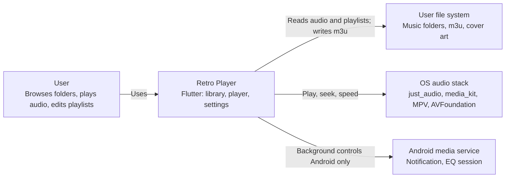

### Level 2 — Containers

Major runnable / deployable parts inside the app boundary.

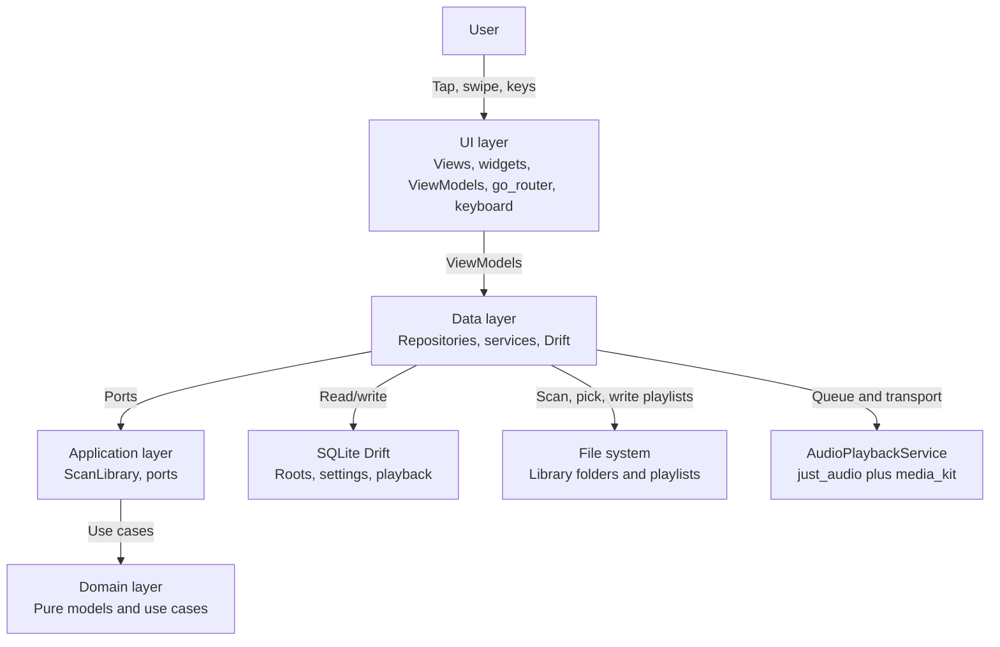

### Level 3 — Components (logical)

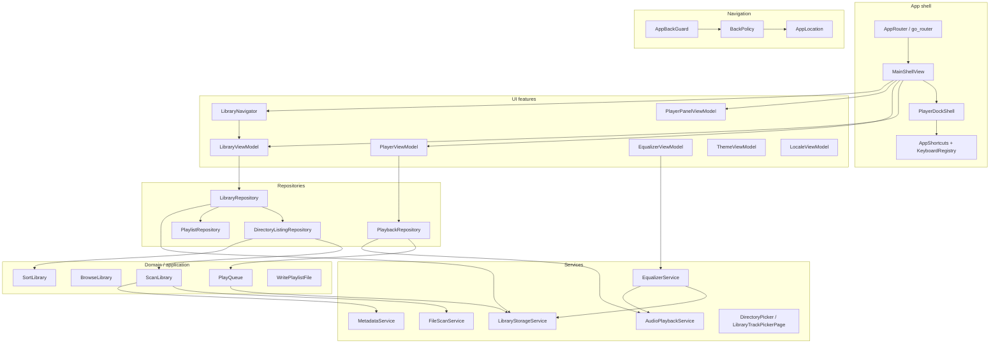

### Code layout (reference)

| Path | Role |
|------|------|
| `lib/main.dart` | DI (`MultiProvider`), `GoRouter`, session bootstrap |
| `lib/ui/core/` | Router, shell, `AppLocation`, `BackPolicy`, keyboard, lifecycle |
| `lib/ui/features/library/` | Browse UI, `LibraryViewModel`, `LibraryNavigator` |
| `lib/ui/features/player/` | Per-route `PlayerSheetHost`, controls, `PlayerViewModel` |
| `lib/ui/features/playlist/` | Playlist detail (edit only app-created) |
| `lib/ui/features/settings/` | Theme, locale, equalizer, about |
| `lib/application/` | `ScanLibrary` and ports (`LibraryScanner`, `TrackMetadataReader`) |
| `lib/domain/` | Pure Dart models and use cases (no Flutter, `dart:io`, or data) |
| `lib/data/repositories/` | Facades: listings, playlists, playback |
| `lib/data/services/` | I/O, platform, Drift access |
| `lib/data/db/` | Drift schema, migrations, DAOs |

---

## 3. Layer responsibilities

Guarded by `test/architecture/layering_test.dart`.

### UI

- Renders lists, player chrome, settings.
- **ViewModels** are plain classes with constructor-injected dependencies. No `BuildContext`, no navigation.
- Side effects leave as `LibraryEffect` values that `LibraryNavigator` executes.
- Position ticks use `PlayerViewModel.positionListenable`; widgets `context.select` so ticks do not rebuild the shell.

### Application

- `ScanLibrary` and ports (`LibraryScanner`, `LibraryFileSystem`, `TrackMetadataReader`).
- May use pure `dart:` libraries; must not import `lib/data` or Flutter.

### Domain

- **Use cases** encode rules: sort, group albums, browse, write M3U, `PlayQueue`.
- **Models** are immutable (`AudioTrack`, `LibraryItem`, `PlaybackItem`, `DirectoryListingUpdate`).
- No Flutter, `dart:io`, data, or UI imports.

### Data

- **Repositories** compose ports + services; cache finished directory listings.
- **DAOs** (`LibraryRootsDao`, `PlaybackStateDao`, `BrowsePrefsDao`, `AppPrefsDao`, `PlaylistRegistryDao`) sit behind `LibraryStorageService`.
- **Services** wrap Drift, `dart:io`, pickers, `just_audio`. Tag reads run on a background isolate.

---

## 4. Routing and shell

### go_router routes

| Route | Path | Widget | Notes |
|-------|------|--------|-------|
| Library shell | `/` | `MainShellView` | Embeds `LibraryView` or expanded `PlayerView` |
| Album detail | `/album-detail` | `AlbumDetailView` | `extra`: `AudioAlbum` |
| Playlist detail | `/playlist-detail` | `PlaylistDetailView` | `extra`: `PlaylistFile` |
| Queue | `/queue` | `PlaybackQueueView` | Composed queue; save picks a library folder |
| Settings | `/settings` | `SettingsView` | |

All routes sit under `ShellRoute` → `PlayerDockShell` (`AppShortcuts` + a collapsed bar only on routes that do **not** host a sheet, e.g. Settings).

Library, album detail and playlist detail each wrap their body in **`PlayerSheetHost`**. The sheet lives under that page's AppBar. It is not hoisted into `PlayerDockShell`.

**`AppLocation`** is the typed reading of the current route (library / album / playlist / settings, sheet expanded, dialog open). **`BackPolicy`** is the single decision table for system back, predictive-back, and Escape; `AppBackGuard` and keyboard Escape both call it.

Settings subpages (`DataStorageView`, `OpenSourceLicensesView`) use **`Navigator.push`**, not go_router.

Cold start always opens the library shell. **`AppSessionBootstrap`** runs **`LibraryViewModel.ensureLoaded()`** and **`PlayerViewModel.restoreLastSession()`** in **parallel**, then applies the equalizer. Browse path and optional album detail reopen come from `ensureLoaded`; playback queue and position come from restore. The mini player can appear from a **persisted title snapshot** (`hasSession`) before `just_audio` finishes `setQueue` (`hasTrack` gates transport). Device timing for the 23-track scenario is recorded in [cold-start-baseline.md](cold-start-baseline.md).

App bar titles are fixed: Library, Album, Playlist, Queue, Now Playing, and Settings. The open folder stays in the breadcrumb (`LibraryPathSummary`). A trail shorter than the bar starts at the left. A longer trail keeps the current segment on screen and lets earlier segments scroll. Album and playlist names stay in the page body. While selecting playlist tracks, the title is the selected-count line. Settings subpages keep their own titles.

### Shell behavior

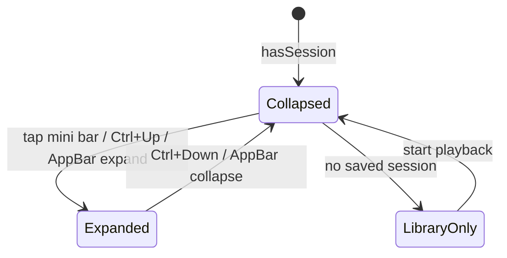

**`hasSession`** (mini bar / sheet padding): saved snapshot or engine has `currentTrack`. **`hasTrack`**: engine queue hydrated — play, seek, and shortcuts require this.

**AppBar vs sheet on expand/collapse:** [`MainShellView`](lib/ui/core/main_shell_view.dart) title and breadcrumb follow [`PlayerPanelViewModel.appBarChromeT`](lib/ui/features/player/view_models/player_panel_view_model.dart) (sheet extent, frozen during predictive-back scrub). Expand/collapse commands no longer snap chrome before [`AnimatedSheetAnimator`](lib/ui/features/player/view_models/sheet_animator.dart) finishes. Regression: [`main_shell_app_bar_expand_test.dart`](test/ui/core/main_shell_app_bar_expand_test.dart) uses the real animator.

---

## 5. Persistence model

### Drift tables (`lib/data/db/tables.dart`)

| Table | Purpose |
|-------|---------|
| `library_roots` | Added folder paths and `sort_order` for root reordering |
| `playback_states` | Resume: item id, track id, position, speed; optional **snapshot** columns `display_title`, `subtitle`, `duration_ms` for cold-start mini player before engine hydrate |
| `app_settings` | Theme, locale, EQ, browse path, album detail id, favorite folders, app-created playlist paths, composed queue (`playback_queue`: ordered paths and index). |

**Schema version 1** (first public release): tables above match `tables.dart`. No upgrade migrations — delete local `retroplayer.db` after schema changes during development.

### File deletion policy

| Action | Touches disk? | Allowed? |
|--------|---------------|----------|
| Remove library root | No — drops root from `library_roots` only | Yes |
| Remove playlist track entry + save | Yes — rewrites that playlist `.m3u` | Yes (user edit) |
| Delete playlist | Yes — deletes `.m3u` file | **Only if app-created** (`LibraryStorageService.markAppCreatedPlaylist`) |
| Delete audio / folders / external playlists | — | **Never** |

Enforced in `LibraryRepository.deletePlaylist` and UI (`PlaylistDismissible`, keyboard Delete) via `LibraryViewModel.isDeletablePlaylist`.

### Playback item IDs

| Kind | ID pattern | Example |
|------|------------|---------|
| Folder | `folder:{path}` | `folder:/music/Author` |
| Album | album id (directory-based) | `dir:/music/Author/Book1` |
| Playlist | `playlist:{normalizedPath}` | `playlist:/music/road.m3u` |
| Queue | `queue` | `queue` |

Save triggers: periodic timer in `PlayerViewModel`, pause/seek/skip, `PlaybackLifecycle` on app exit. Progress saves also write snapshot title/subtitle/duration when a track is loaded.

---

## 6. Input modalities

### Summary matrix

| Action | Mouse / pointer | Touch | Keyboard (desktop) |
|--------|-----------------|-------|---------------------|
| Browse folder | Click row | Tap row | ↑↓ select, Enter open |
| Favorite folder | Swipe right on a nested folder | Swipe right | — |
| Play folder | Click ▶ on row | Tap ▶ | Space on selected folder |
| Play album | Click ▶ | Tap ▶ | Space on selected album |
| Open album | Click row (not ▶) | Tap row | Enter |
| Play track | Click row | Tap row | Space |
| Open playlist | Click row body | Tap body | Enter |
| Play playlist | Click ▶ on the library row, or tap a row in detail | Tap ▶ or a detail row | Space |
| Remove library root | Swipe + confirm | Swipe | Delete on selected root |
| Delete playlist | Swipe + confirm (app-created only) | Swipe (app-created only) | Delete on selected app-created playlist |
| Add folder | FAB | FAB | Ctrl+O |
| Open queue | App bar (including the library root) | App bar | Ctrl+N |
| Player transport | Buttons, seek bar; maximized player jumps 15 s beside the album art | Buttons, seek bar; 15 s buttons and a double tap on each half of the art | Ctrl+P, Ctrl+←/→, Ctrl+Shift+←/→ (15 s) |
| Expand player | App bar / mini bar | Tap mini bar | Ctrl+↑ / Ctrl+↓ |
| Settings rows | Click controls | Tap controls | ↑↓, Space, Enter |
| Playlist save | Save stays grey until the list differs from the file, then turns orange | Same | Ctrl+S (on playlist route; no-op when nothing changed) |
| Reorder playlist entries | Long-press a row, then drag | Long-press a row, then drag | — |
| Select playlist tracks | Checklist, then Select all / Deselect all | Same | Escape leaves select mode |
| Add tracks | Add tracks, then Select all in the open folder | Same | Ctrl+O on the playlist route |
| Parent folder | Breadcrumb / Up | Breadcrumb | Alt+←, Backspace |
| Back from overlay | Back gesture / button | Back | Escape |
| Back (same rules as Escape) | AppBar ← when [`AppBarBackLeading`](lib/ui/core/navigation/app_bar_back_leading.dart) applies (`isDesktopHost` only; hidden at library root) | — | Alt+←, Backspace, Escape |

### Desktop-only keyboard

- Wrapped in `AppShortcuts` when `isDesktopHost()` (`lib/ui/core/keyboard/desktop_host.dart`).
- Suppressed while `EditableText` / `TextField` focused.
- Route-specific handlers via `KeyboardRegistry` (shell, playlist, settings, settings subpages).
- Full shortcut table: [DEVELOPMENT_PLAN.md § Key navigation](DEVELOPMENT_PLAN.md#key-navigation-desktop--linux--windows--macos).

### Touch / mobile notes

- **No separate touch API** — standard Flutter `InkWell` / `ListTile` / `Dismissible`.
- **Android / iOS:** full-screen; permissions via `PermissionService` before folder pick.
- **Desktop:** optional **letterbox** (`MobileLayout`) constrains UI to ~430×920; pointer events behave as mouse.
- **Reorder:** long-press a row in an app-created playlist, then drag. Swipe still removes one entry. Disk playlists are read-only (badge, no save, no reorder).

### What is not implemented yet

- **OS media keys / MPRIS** on desktop — **Linux implemented** via `audio_service_mpris` + `RetroAudioHandler` (see [§11](#11-planned-features)).
- Dedicated **gamepad** input.

Touch paths require **automated widget/gesture tests**, not manual-only QA — see [AUTOMATED_TESTING.md §6](AUTOMATED_TESTING.md#6-touch--gesture-tests-required).

---

## 7. Use-case catalog and call chains

Each subsection lists: **trigger → UI → ViewModel → Repository → Use case → Service**.

### 7.1 Add library root

**Triggers:** FAB “Add folder”; `Ctrl+O` (shell).

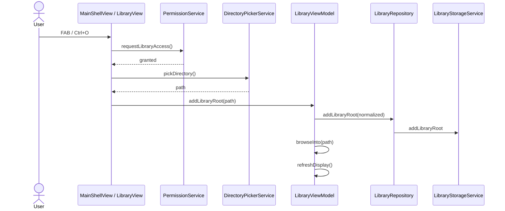

### 7.2 Remove library root

**Triggers:** Swipe root row; `Delete` on selected root (keyboard).

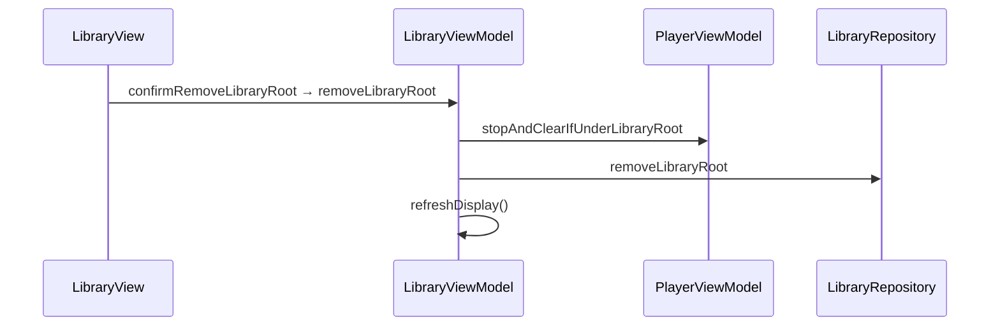

### 7.3 Browse folders (folder mode)

**Triggers:** Tap folder; breadcrumb; keyboard Enter on folder; `browseInto` from code. At the library root, a long press on a **Library sources** row reorders added roots; order is stored in `library_roots.sort_order`. Swipe right on a nested folder toggles `favorite_folders` and shows that folder as a starred link at the library root. A long press on a favorite link reorders that list; the new path order is written back to `favorite_folders`.

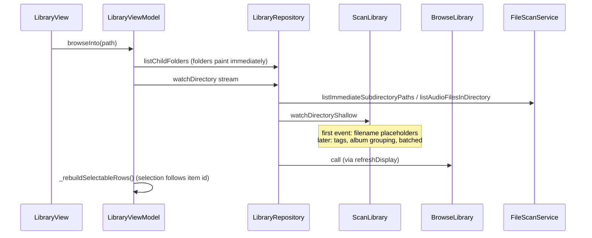

**Parent navigation:** `browseUp` / `navigateToParentFolder` — restores keyboard selection on exited folder.

Directory items stay in track-number order, then title (`SortLibrary`). There is no sort menu and no tree view.

### 7.6 Manual reorder

Removed. Lists use track number, then title.

### 7.7 Play folder

**Triggers:** Folder ▶; keyboard Space on folder row.

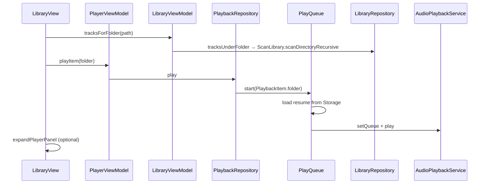

### 7.8 Play album / track

**Triggers:** Album ▶ or track tap; album detail track tap; keyboard Space.

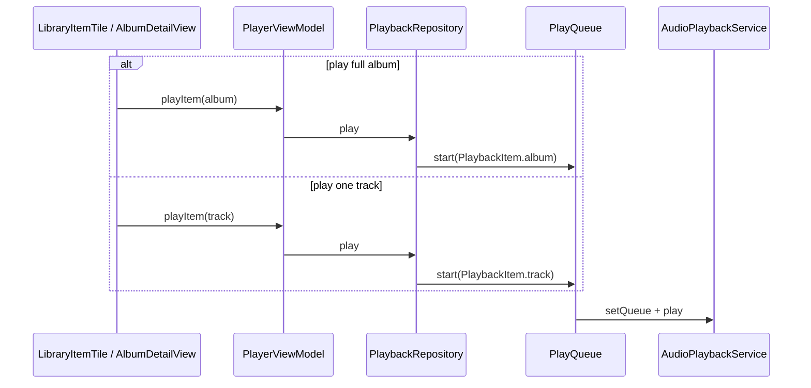

### 7.9 Open album detail

**Triggers:** Tap album row; keyboard Enter.

`LibraryNavigator.openAlbumDetail` → `context.push('/album-detail', extra: album)` after `LibraryViewModel.rememberAlbumDetail`.

### 7.10 Play playlist / open detail / play entry

**Triggers:** Playlist ▶; tap body; tap entry in detail; keyboard.

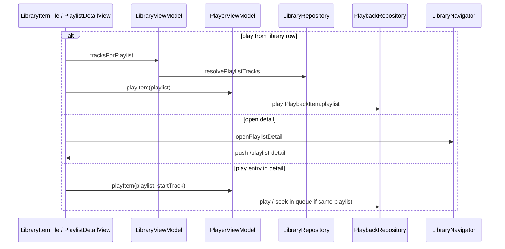

### 7.11 Queue, then save as a playlist

**Triggers:** App bar queue button (also at the library root); `Ctrl+N`. Save on the queue screen.

Playing a folder, album, or file playlist still replaces what is playing. That does not delete the stored queue. Advancing playback updates the stored index and keeps tracks that have already played. A queue row tap plays from that track using preview paths first; tags replace titles in place when they arrive. Clear on the queue app bar empties the stored list after confirmation and stops playback only when that queue is current. The queue app bar has no play button. The playlist detail app bar has no play button either; a row tap there still starts playback.

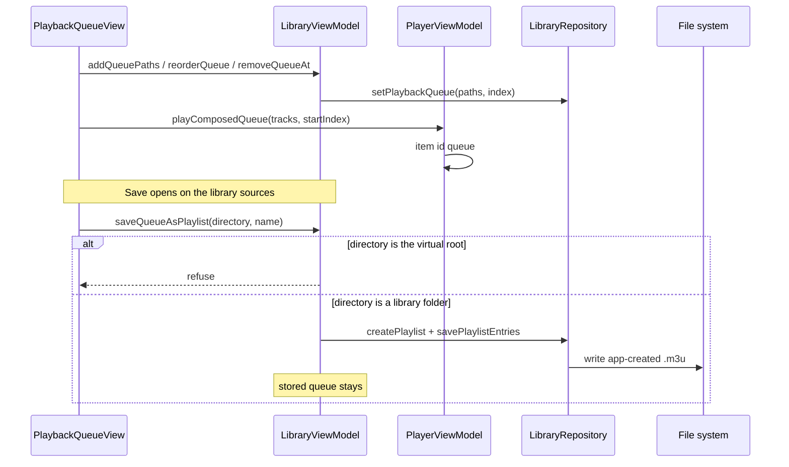

### 7.12 Save / edit playlist

**Triggers:** Save in playlist detail (orange only when `_entryPaths` differ from the file; grey and disabled otherwise); `Ctrl+S` on the playlist route; add/remove/reorder entries.

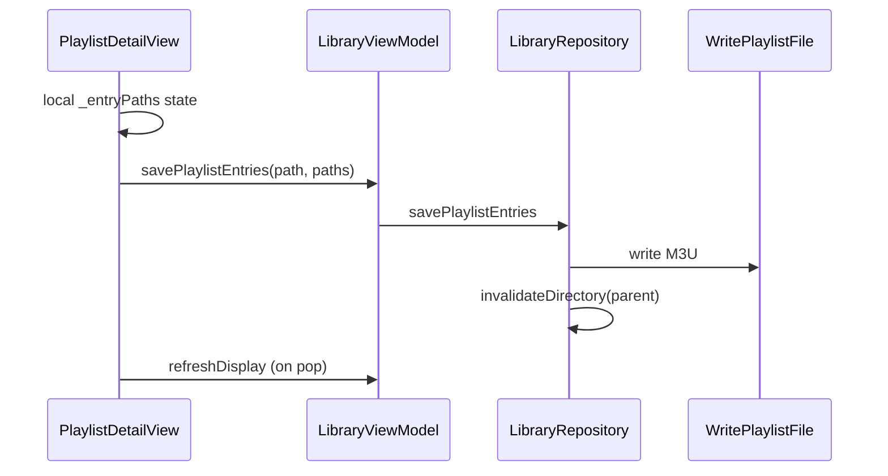

**Add tracks:** `LibraryTrackPickerPage` browses library roots only. Checkboxes multi-select audio in the open folder; **Select all** checks every new file there and **Deselect all** clears that selection. Files already in the playlist stay greyed out, in folder order, and are not selectable. Confirm runs `filterNewPlaylistEntries` and appends the new paths. Save still writes the file.

**Select on the playlist:** the checklist enters select mode. **Select all** checks every entry; the same control becomes **Deselect all** and clears them. Tapping a row toggles that entry. Escape or the close button leaves select mode without popping the route. Back uses `BackPolicy.consumeLocalBack`.

### 7.13 Delete playlist

**Triggers:** Swipe on playlist row; `Delete` key.

`LibraryViewModel.deletePlaylist` → `LibraryRepository.deletePlaylist` (deletes `.m3u` file) → refresh.

### 7.14 Player transport & speed

**Triggers:** Controls, mini bar, keyboard, (Android) notification. Maximized player: 15-second buttons beside the album art, and a double tap on the left or right half of the art. Ctrl+Shift+←/→ call the same jump.

`PlayerViewModel` (`jumpBy` seeks) → `PlaybackRepository` → `AudioPlaybackService` (`pause`, `play`, `seek`, `skipToNext`, `setSpeed`).

Progress saved via `PlaybackRepository.saveProgress` / use-case `saveProgress`.

### 7.15 Playback persistence & session restore

**Startup (parallel):**

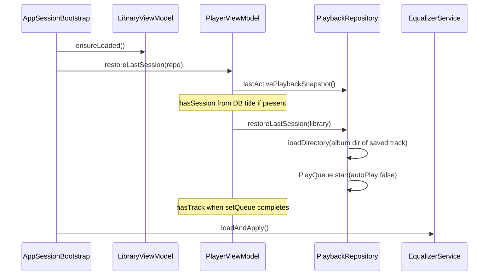

1. **`lastActivePlaybackSnapshot`** — reads `playback_states` + last active item id; **`PlayerViewModel`** applies title/subtitle/position/duration for the dock (`_awaitingEngineHydrate`).
2. **`restoreLastSession`** — **`_warmDirectoryForSavedTrackPath`** calls **`LibraryRepository.loadDirectory`** on the saved track’s parent folder so album lookup does not walk every root; then **`PlayQueue.start`** builds the native queue paused at the saved index/position.
3. **`LibraryViewModel.ensureLoaded`** — restores browse path, queue paths, and **`refreshDisplay`** independently.

Repository tests: `cold_start_bootstrap_test.dart`, `playback_repository_restore_perf_test.dart`. Manual medians: [cold-start-baseline.md](cold-start-baseline.md).

**Shutdown:** `PlaybackLifecycle` → save + `shutdown`. Android Recents swipe → `MainActivity.onStop` (finishing) → `AndroidRecentsPlaybackBridge`, plus `RetroAudioHandler.onTaskRemoved` when delivered — both call `stopPlaybackForRecentsDismiss` and idle the media session (`stopWithTask` on the media service).

See call chain in `play_*` use cases for per-item resume.

### 7.16 Jump to now playing

**Triggers:** Breadcrumb segment when player expanded.

`LibraryNavigator.jumpToPlaybackBreadcrumb` / `jumpToNowPlaying` → `LibraryViewModel.locateNowPlaying` returns a `LibraryEffect`; the navigator opens album or playlist detail.

### 7.17 Equalizer

**Triggers:** Settings segmented presets + sliders; keyboard Space on row.

`EqualizerViewModel` → `EqualizerService.saveAndApply` → platform backend (MPV `af` / Android session).

### 7.18 Theme & locale

**Triggers:** Settings appearance / language segments.

`ThemeViewModel` / `LocaleViewModel` → `LibraryStorageService` → `MaterialApp` rebuild via `Consumer2`.

### 7.19 Settings & about

**Triggers:** App bar gear; `Ctrl+,`.

Settings list keyboard: `SettingsView` registers `KeyboardRegistry.settings`.

Subpages: `Navigator.push`; `SettingsSubpageKeyboard` mixin handles Backspace / Alt+←.

---

## 8. Automated testing

Full coverage tables, run commands, helpers, touch/gesture requirements, and priority backlog:

**→ [AUTOMATED_TESTING.md](AUTOMATED_TESTING.md)**

Summary (Oct 2026): see the count at the top of [AUTOMATED_TESTING.md](AUTOMATED_TESTING.md). Use-case mapping and remaining gaps live in [TEST_PLAN.md](TEST_PLAN.md).

---

## 9. C4 Level 4 — Code map

Per-feature classes, primary methods, and dependencies. Arrows read as “calls” or “depends on”.

### 9.1 Application entry & DI

| Class | File | Role |
|-------|------|------|
| `RetroPlayerApp` | `lib/main.dart` | `MultiProvider`, `MaterialApp.router`, theme/locale |
| `AppSessionBootstrap` | `lib/ui/core/app_session_bootstrap.dart` | Startup: parallel `ensureLoaded` + `restoreLastSession`, then EQ |
| `PlaybackLifecycle` | `lib/ui/core/playback_lifecycle.dart` | Exit: cancel audio-session sub, shutdown playback, close DB |

**Providers (main):** `LibraryRepository`, `PlaybackRepository`, `EqualizerService`, `LibraryViewModel`, `PlayerViewModel`, `PlayerPanelViewModel`, `KeyboardRegistry`, settings VMs.

### 9.2 Shell & routing

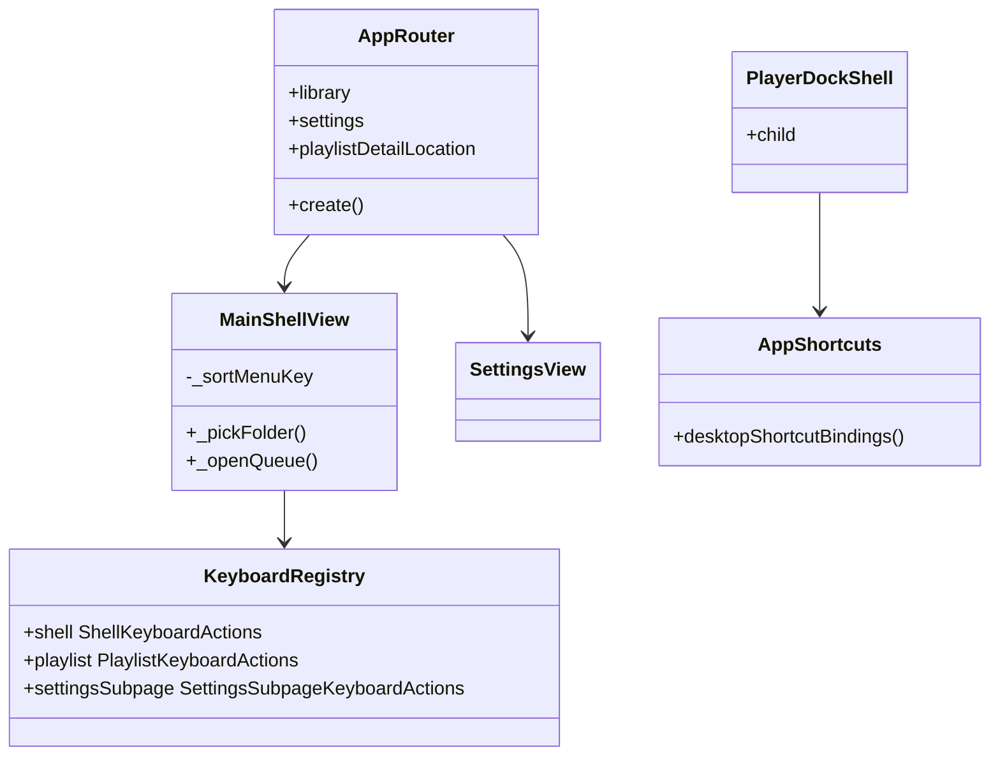

| Class | Key methods | Collaborators |
|-------|-------------|---------------|
| `AppRouter` | `create`, route builders | `MainShellView`, `AlbumDetailView`, `PlaylistDetailView`, `SettingsView` |
| `MainShellView` | `_pickFolder`, `_openQueue` | `LibraryViewModel`, `KeyboardRegistry.shell` |
| `PlayerDockShell` | build: dock + child | `PlayerPanelViewModel`, `AppShortcuts` |
| `KeyboardRegistry` | `setPlaylist`, `setSettingsSubpage` | Shortcut actions in `shortcut_actions.dart` |

### 9.3 Library feature

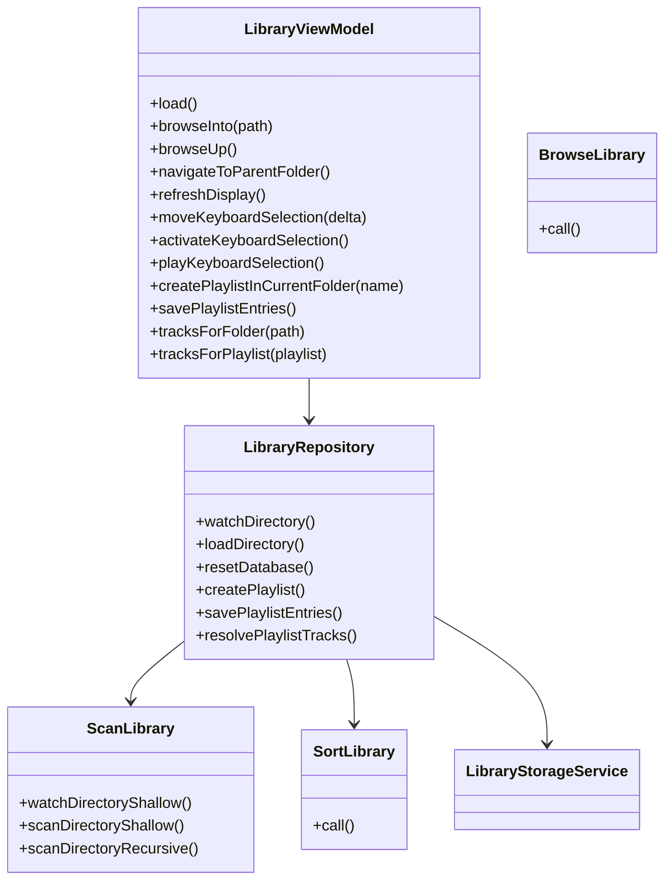

| UI widget | ViewModel / action |
|-----------|-------------------|
| `LibraryView` | `refreshDisplay`, FAB add folder |
| `LibraryItemTile` | `LibraryNavigator` + `PlayerViewModel.playItem` |
| `LibraryPathSummary` | `navigateToBrowsePath`, jump-to-playing |
| `library_remove_confirmation.dart` | confirm dialogs |

### 9.4 Player feature

| Class | File | Key methods |
|-------|------|-------------|
| `PlayerViewModel` | `player_view_model.dart` | `playItem`, `togglePlayPause`, `seek`, `jumpBy`, `setSpeed`, `restoreLastSession`; `hasSession` / `hasTrack`; `positionListenable` |
| `PlayerPanelViewModel` | `player_panel_view_model.dart` | injected `SheetAnimator`; `expand`, `collapse`, `toggle` |
| `PlaybackRepository` | `playback_repository.dart` | `PlayQueue`, `restoreLastSession`, `lastActivePlaybackSnapshot`, album-dir warm-up on restore |
| `JustAudioPlaybackService` | `audio_playback_service.dart` | `setQueue`, `play`, `pause`, `seek`, streams |
| `RetroAudioHandler` | `retro_audio_handler.dart` | Android `audio_service` bridge |

Widgets: `PlayerSheetHost` (per route), `PlayerLibrarySheet`, `PlayerCollapsedBar`, `PlayerControls`, `NowPlayingContent`, `RetroProgressBar`.

### 9.5 Playlist feature

| Class | File | Key methods |
|-------|------|-------------|
| `PlaylistDetailView` | `playlist_detail_view.dart` | `_playFromEntry`, `_save`, `_addTracks`, `PlaylistKeyboardActions` registration |
| `WritePlaylistFile` | `domain/use_cases/write_playlist_file.dart` | atomic M3U write |
| `ParsePlaylistFile` | `domain/use_cases/parse_playlist_file.dart` | read M3U |
| `ResolvePlaylistPaths` | `domain/use_cases/resolve_playlist_paths.dart` | path → `AudioTrack` |

### 9.6 Settings feature

| Class | File | Persists via |
|-------|------|--------------|
| `ThemeViewModel` | `theme_view_model.dart` | `LibraryStorageService` → `app_settings` |
| `LocaleViewModel` | `locale_view_model.dart` | same |
| `EqualizerViewModel` | `equalizer_view_model.dart` | `EqualizerService` → storage + backend |
| `SettingsView` | `settings_view.dart` | Tab/focus-only; native `SegmentedButton` / `Slider` / `ListTile` focus |

### 9.7 Data & persistence

| Class | File | Responsibility |
|-------|------|----------------|
| `LibraryStorageService` | `library_storage_service.dart` | All Drift CRUD: roots, settings, playback, sort orders, app-created playlist registry |
| `LibraryRepository` | `library_repository.dart` | Directory cache, scan orchestration, playlists (create/delete guarded) |
| `FileScanService` | `file_scan_service.dart` | Directory listing, extension filter |
| `MetadataService` | `metadata_service.dart` | Tags via `just_audio` / file metadata |
| `EqualizerService` | `equalizer_service.dart` | Load/save EQ, `reapplyLast`, backend factory |

Drift tables: see [§5 Persistence model](#5-persistence-model).

### 9.8 Keyboard module

| File | Exports / role |
|------|----------------|
| `shortcut_bindings.dart` | `Map<ShortcutActivator, Intent>` |
| `shortcut_intents.dart` | Intent types |
| `shortcut_actions.dart` | `buildDesktopShortcutActions`, dispatch to registry/VMs |
| `selectable_library_row.dart` | Row model for library keyboard focus |
| `selectable_settings_row.dart` | Legacy row model (unit tests only; Settings uses native focus) |
| `shortcut_labels.dart` | Tooltip strings (`withDesktopShortcut`) |

---

## 10. Extension points

| Extension | Hook |
|-----------|------|
| New EQ preset | `EqualizerPreset` + `EqualizerFilterBuilder` |
| New platform equalizer | `EqualizerBackend` + factory |
| New library item type | `LibraryItem` sealed variant + tile + scan |
| New keyboard context | `KeyboardRegistry` + `shortcut_bindings.dart` |
| New route | `AppRouter` + shell registration if needed |
| OS media transport | `MediaTransportBridge` facade (see §11) |

---

## 11. Planned features

### 11.1 OS media keys & desktop integration

**Current state:**

| Platform | Mechanism | Play/pause/skip |
|----------|-----------|-----------------|
| **Android** | `audio_service` + `RetroAudioHandler` in `main.dart` | Notification + BT headset via system |
| **iOS** | `AudioSession` + `just_audio`; limited handler wiring | Lock screen / Control Center — partial |
| **Linux desktop** | In-app shortcuts + **MPRIS** (`audio_service_mpris`) | Taskbar/media keys via D-Bus when `AudioService` is active |
| **Windows / macOS** | In-app shortcuts only | **No SMTC / Now Playing** integration |

The Android and Linux media item carries the title (file name when the tag is missing), artist, album (folder name when the tag is missing), and the display lines a car head unit reads.

**Desired (desktop):** Hardware media keys and DE media applets (GNOME/KDE MPRIS, Windows media overlay, macOS Control Center) should control playback when the app has an active queue.

**Options (evaluate in order):**

1. **MPRIS via media_kit / platform channel (Linux)** — `just_audio_media_kit` already uses MPV; expose D-Bus MPRIS from same process or companion. Best fit for Linux-first desktop builds.
2. **`audio_service` on desktop** — package supports multiple platforms; would unify with `RetroAudioHandler` but adds background service semantics on desktop.
3. **Flutter `HardwareKeyboard` / raw key listening** — catches some keyboard media keys but not MPRIS/SMTC; insufficient alone for taskbar applets.
4. **Platform plugins** — `windows_media`, macOS `MPNowPlayingInfoCenter` via method channel.

**Recommended approach:**

- Introduce a thin **`MediaTransportBridge`** interface in `lib/data/services/`:
  - `publishNowPlaying(metadata, position, duration, playing)`
  - `registerCallbacks(onPlay, onPause, onSkipNext, onSkipPrevious, onSeek)`
- **Android:** keep `RetroAudioHandler` as the implementation.
- **Linux:** MPRIS implementation (new; likely native or `dbus` package).
- **Windows/macOS:** phase 2 after Linux MPRIS.
- Wire `PlayerViewModel` / `PlaybackRepository` to push state updates and receive commands.
- **Tests:** fake bridge unit tests; Linux integration test optional with mocked D-Bus.

**Relation to in-app shortcuts:** Desktop shortcuts remain; MPRIS is additive for OS-level control.

---

## 12. Architecture decisions

Recorded answers (July 2026):

| # | Topic | Decision |
|---|--------|----------|
| 1 | Test detail location | **Yes** — moved to [AUTOMATED_TESTING.md](AUTOMATED_TESTING.md); this file keeps summary only |
| 2 | `SortOrderRepository` | **Removed** — sort persistence stays on `LibraryRepository` → `LibraryStorageService` only |
| 3 | Touch QA | **No** — manual matrix alone is not enough; require automated gesture tests |
| 4 | OS media keys | **Elaborated in §11.1** — planned via `MediaTransportBridge` |
| 5 | Context menus | **Not needed** — existing taps, swipe, keyboard, and buttons cover actions |
| 6 | C4 Level 4 | **Yes** — §9 |
| 7 | File deletion | **Never delete user files** except app-created playlist `.m3u` files (see [§5](#5-persistence-model)) |
| 8 | `albums` / `tracks` catalog | **Dropped in schema v2** — browse is a live scan of disk |
| 9 | State management | **Provider for now.** View models are plain constructor-injected classes so a Riverpod move is one-to-one (see [§13](#13-riverpod-migration-notes)) |
| 10 | Player sheet | **One host per route** under that page's AppBar, not a hoisted sheet in `PlayerDockShell` |

---

## 13. Riverpod migration notes

Provider stays. The current shape is already Riverpod-ready:

- Each view model is a plain class with constructor dependencies (no `BuildContext`, no `context.read` of other view models, no navigation).
- A `ChangeNotifierProvider<PlayerViewModel>` maps to a `Notifier` / `ChangeNotifierProvider` in `flutter_riverpod` one-to-one.
- Side effects are `LibraryEffect` values executed by `LibraryNavigator`, not by the view model.
- Ports in `lib/application/ports` are the overrides you would bind in a Riverpod `ProviderScope`.

Do not introduce `WidgetRef` or `ConsumerWidget` until a dedicated migration pass.
