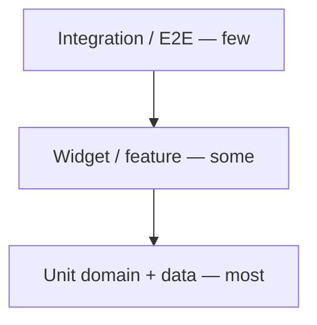

# Retro Player — Automated testing

How tests are organized, what they guard, how to run them, and what is still missing. For system design see [ARCHITECTURE.md](ARCHITECTURE.md).

**Last count:** 425 passed, 1 skipped (`flutter test`, Oct 2026, Flutter 3.47.8). Use-case mapping: [TEST_PLAN.md](TEST_PLAN.md).

---

## Table of contents

1. [Test pyramid](#1-test-pyramid)
2. [Layout (mirrors `lib/`)](#2-layout-mirrors-lib)
3. [Running tests](#3-running-tests)
4. [Conventions](#4-conventions)
5. [Coverage by use case](#5-coverage-by-use-case)
6. [Touch & gesture tests (required)](#6-touch--gesture-tests-required)
7. [Planned tests (priority)](#7-planned-tests-priority)
8. [Future features needing tests](#8-future-features-needing-tests)
9. [Test file catalog](#9-test-file-catalog)

---

## 1. Test pyramid



| Layer | Location | Purpose |
|-------|----------|---------|
| **Unit** | `test/domain/`, `test/data/` | Use cases, path rules, Drift, services with fakes |
| **Widget** | `test/ui/` | Screens, keyboard, one user gesture path |
| **Integration** | `test/integration/`, `integration_test/` | MPV lifecycle, persistence restart, cold-start harness |

Prefer **unit tests** for business rules; **widget tests** for wiring and one happy path; **integration** only where platform or full stack matters.

**Cold-start timing:** structure is asserted in `cold_start_bootstrap_test.dart` and `playback_repository_restore_perf_test.dart`; record release-build medians on a device in [cold-start-baseline.md](cold-start-baseline.md).

---

## 2. Layout (mirrors `lib/`)

```
test/
├── architecture/     # layering_test (domain / application import rules)
├── application/      # PlayQueue, ScanLibrary progressive listing
├── domain/           # use_cases, models, equalizer, playlist_entry_validation
├── data/             # db, repositories, services
├── privacy/          # no INTERNET (release), dep denylist, MPV file-only, remote M3U reject
├── ui/
│   ├── core/         # router, AppLocation, BackPolicy, bootstrap
│   ├── features/
│   │   ├── library/
│   │   ├── player/
│   │   ├── playlist/
│   │   └── settings/
│   ├── performance/  # position-tick rebuild gate
│   └── l10n/
├── integration/      # linux playback, persistence_restart
├── dev/              # persistence harness
└── helpers/          # pump_app, real_app, recording_playback, seeds
```

Privacy guards in `test/privacy/` enforce local-only / no-telemetry invariants (see root README Privacy section).

Every new feature should add tests in the matching folder before merge.

---

## 3. Running tests

```bash
# Full suite
flutter test

# One file
flutter test test/application/play_queue_test.dart

# Keyboard + library selection
flutter test test/ui/core/keyboard test/ui/features/library/library_keyboard_selection_test.dart

# Integration (Linux MPV; may need display/libmpv)
flutter test test/integration/

# Device E2E
flutter test integration_test/
```

Coverage (optional):

```bash
flutter test --coverage
# LCOV report: see .cursor/skills/dart-collect-coverage or project scripts
```

---

## 4. Conventions

### Fakes and seeds

| Helper | Role |
|--------|------|
| `RecordingPlayback` | Captures `setQueue`, `play`, seek index; `emitPosition` |
| `testLibraryRepository(storage)` | Wired repo for widget tests |
| `seedAuthorBook1Hierarchy` | Multi-level folder + album |
| `keyboard_test_helpers.dart` | `sendShortcut`, `sendPlainKey` (list nav; no global focus steal) |
| `pump_app.dart` | `wrapWithL10n`, `wrapRouterWithL10n`, `pumpFrames`, `enL10n` |
| `real_app.dart` | `pumpRealApp`: production `AppRouter`, `MainShellView`, full providers |
| `sendSystemBackGesture` | Predictive-back channel (Android edge swipe). Prefer over `handlePopRoute` |
| `recordFrameworkHandlesBack` | Assert Android back ownership |
| `pumpUntil` | Wait for a condition instead of a fixed frame count |

### Widget test providers

Screens under `AppRouter` need at minimum:

- `LibraryViewModel`, `PlayerViewModel`, `PlayerPanelViewModel`, `KeyboardRegistry`
- Settings: `EqualizerViewModel`, `ThemeViewModel`, `LocaleViewModel`
- Wrap providers **above** `MaterialApp` when subpages use `Navigator.push` (so `KeyboardRegistry` is in scope).

### What not to test

- Generated l10n strings in every locale (spot-check DE in `settings_l10n_test.dart` is enough).
- Pixel-perfect layout (golden tests only if explicitly requested).

---

## 5. Coverage by use case

Legend: ✅ covered · ⚠️ partial · ❌ gap

### Library & browse

| Scenario | Level | Test file(s) | Status |
|----------|-------|--------------|--------|
| Browse folders / breadcrumbs | unit + widget | `browse_library_test.dart`, `library_browse_widget_test.dart`, `library_path_summary_test.dart` | ✅ |
| Track-number order | unit | `sort_library_test.dart` | ✅ |
| Remove library root (swipe) | widget | `library_remove_root_test.dart` | ✅ |
| Favorite folder | unit + widget | `library_favorites_test.dart` (mark, clear, long-press reorder persisted) | ✅ |
| Library source order | unit + widget | `library_root_order_test.dart` (long-press reorder roots at library root) | ✅ |
| Add library root (picker) | — | — | ❌ |
| Queue screen | unit + widget | `playback_queue_test.dart` | ✅ |
| Jump to playing | widget | `library_jump_to_playing_test.dart` | ✅ |
| Session browse path | unit | `library_view_model_session_test.dart` | ✅ |
| Album detail session | widget | `library_album_detail_session_test.dart` | ✅ |
| Keyboard selection / parent | unit | `library_keyboard_selection_test.dart` | ✅ |
| Parent browse-up scroll restore | unit + widget | `library_keyboard_selection_test.dart`, `library_list_scroller_test.dart`, `library_parent_scroll_restore_test.dart` | ✅ |
| Scroll restore after Settings | widget | `library_parent_scroll_restore_test.dart` | ✅ |
| Edge-back after Settings | widget | `app_back_guard_test.dart` | ✅ |
| Folders before tag scan | unit | `browse_shows_folders_before_scan_test.dart` | ✅ |
| Progressive listing | unit | `scan_library_progressive_test.dart`, `library_progressive_scan_test.dart` | ✅ |
| Position-tick rebuilds | widget | `ui/performance/position_rebuild_test.dart` | ✅ |
| Lazy folder covers | unit | `lazy_folder_covers_test.dart` | ✅ |
| Library keyboard focus sync | widget | `library_keyboard_integration_test.dart` | ✅ |
| Player keyboard tab order | widget | `player_keyboard_test.dart` | ✅ |
| **Context menu (planned)** | — | — | ❌ |

### Playback

| Scenario | Level | Test file(s) | Status |
|----------|-------|--------------|--------|
| Play folder / album / playlist | unit + widget | `play_queue_test.dart`, `library_browse_widget_test.dart`, `playlist_playback_test.dart` | ✅ |
| Resume / persistence | unit + integration | `play_queue_test.dart` (several albums and a folder), `playback_resume_test.dart`, `persistence_resume_test.dart`, `playback_repository_test.dart`, `player_view_model_persistence_test.dart`, `persistence_restart_test.dart`, `persistence_harness_test.dart` | ✅ |
| 15-second jump | unit + widget | `player_jump_test.dart` | ✅ |
| Player breadcrumbs | widget | `player_view_test.dart` | ✅ |
| Playback speed UI | — | — | ❌ |
| Mini player seek bar | — | — | ❌ |
| Linux MPV lifecycle | integration | `linux_playback_lifecycle_test.dart`, `linux_playback_startup_test.dart`, `linux_mpv_teardown_test.dart` | ✅ |
| **OS media keys (planned)** | — | — | ❌ |

### Playlists

| Scenario | Level | Test file(s) | Status |
|----------|-------|--------------|--------|
| Parse / write M3U | unit | `playlist_file_test.dart` | ✅ |
| Resolve paths | unit | `resolve_playlist_paths_test.dart` | ✅ |
| Entry validation | unit | `playlist_entry_validation_test.dart` | ✅ |
| Repository delete | unit | `library_repository_playlist_test.dart` | ✅ |
| Save playlist UI | — | — | ❌ |
| Add tracks (picker) | — | — | ❌ |
| Playlist keyboard | widget | `playlist_keyboard_test.dart` | ⚠️ |

### Settings

| Scenario | Level | Test file(s) | Status |
|----------|-------|--------------|--------|
| Equalizer VM / presets | unit | `equalizer_view_model_test.dart`, `equalizer_preset_test.dart`, `equalizer_filter_builder_test.dart`, `equalizer_settings_storage_test.dart` | ✅ |
| Theme storage | unit | `theme_preference_storage_test.dart`, `app_theme_test.dart` | ⚠️ |
| Locale / DE title | widget | `locale_preference_storage_test.dart`, `settings_l10n_test.dart` | ⚠️ |
| Licenses navigation | widget | `settings_licenses_test.dart` | ✅ |
| Reset database | unit + widget | `app_database_test.dart`, `settings_reset_database_test.dart` | ✅ |
| Settings keyboard | widget | `settings_keyboard_test.dart` (Tab, ↑/↓ lines, Enter/Space, subpage back) | ✅ |
| Data storage view | — | — | ❌ |
| Equalizer widget | — | — | ❌ |

### Keyboard & routing

| Scenario | Level | Test file(s) | Status |
|----------|-------|--------------|--------|
| Shortcut labels | unit | `shortcut_labels_test.dart` | ✅ |
| Ctrl+P / Ctrl+↑ | widget | `app_shortcuts_test.dart` | ✅ |
| Selectable rows | unit | `selectable_library_row_test.dart` | ✅ |
| Settings return navigation | widget | `settings_return_navigation_test.dart` | ✅ |
| Player dock / sheet shell | widget | `player_dock_shell_test.dart` | ✅ |
| System / AppBackGuard | unit + widget | `back_policy_test.dart`, `app_bar_back_leading_test.dart`, `app_location_test.dart`, `app_back_guard_test.dart`, `system_back_flows_test.dart` | ✅ |
| Layering (domain / application) | unit | `architecture/layering_test.dart` | ✅ |
| Session bootstrap | widget | `app_session_bootstrap_test.dart`, `cold_start_bootstrap_test.dart` | ✅ |
| Library AppBar vs sheet expand | widget | `main_shell_app_bar_expand_test.dart` (`AnimatedSheetAnimator`) | ✅ |
| Cold-start restore structure | unit + widget | `playback_repository_restore_perf_test.dart`, `cold_start_bootstrap_test.dart` | ✅ |

### Domain / data (supporting)

| Area | Test file(s) |
|------|--------------|
| Group tracks → albums | `group_tracks_into_albums_test.dart` |
| Scan / metadata / formats | `file_scan_service_test.dart`, `metadata_service_test.dart`, `playback_format_test.dart` |
| Album art | `find_album_art_test.dart` |
| Drift schema | `app_database_test.dart`, `schema_migration_test.dart`, `library_storage_persistence_test.dart` |
| E2E (limited) | `integration_test/app_test.dart` |

---

## 6. Touch & gesture tests (required)

Manual QA alone is **not** sufficient for touch. Add **widget tests** that simulate gestures via `WidgetTester`:

| Gesture | Widget / flow | Test approach |
|---------|---------------|---------------|
| Tap row | `LibraryItemTile`, folder row | `tester.tap(find.text(...))` — partially covered |
| Tap ▶ play | Trailing `IconButton` | `find.byIcon(Icons.play_arrow_rounded)` — partial |
| Swipe dismiss | `Dismissible` root / app-created playlist | `tester.drag`, `library_remove_root_test.dart` ✅ |
| Drag reorder | Long-press a row on an app-created playlist | `playlist_keyboard_test.dart` long-press then drag ✅ |
| Select all | Playlist checklist and add-tracks folder | tooltip switches to Deselect all; German labels in the same files ✅ |
| Predictive-back scrub | Expanded player sheet | `player_dock_shell_test.dart` keeps Now Playing chrome until collapse ✅ |
| Scroll | Long lists | `tester.scrollUntilVisible` — partial in licenses test |
| Mini player expand | Library / album sheet grabber | drag → continuous expand — `player_dock_shell_test.dart`, `album_player_sheet_test.dart` ✅ |
| Seek bar drag | `PlaybackProgressBar` | `tester.dragFrom` on slider — `player_touch_gesture_test.dart` ✅ |
| Edge-back browse up | Parent folder list | scroll offset + selection restore — `library_parent_scroll_restore_test.dart` ✅ |

**Target:** at least one widget test per swipe/drag/long-press path when the feature ships.

---

## 7. Planned tests (priority)

Covered during the refactor: create/save/delete playlist (`playlist_create_edit_test.dart`), add root (`library_add_root_test.dart`), speed (`player_speed_test.dart`), progressive listing, position rebuilds.

Remaining gaps: [TEST_PLAN.md](TEST_PLAN.md). Shipped since the last doc pass: read-only playlist badge, whole-row reorder, select all / deselect all (playlist and add-tracks), save button grey until there are unsaved edits, predictive-back sheet scrub that does not swap the library AppBar. Scan progress and the root-back snackbar were not added. Manual reorder tests stay retired.

---

## 8. Future features needing tests

When implemented, add tests in the same PR:

| Feature | Test type |
|---------|-----------|
| Desktop OS media keys / MPRIS | integration on Linux; widget mock handler on desktop |
| ThemeViewModel / LocaleViewModel | unit: load + setPreference |

See [DEVELOPMENT_PLAN.md](DEVELOPMENT_PLAN.md) for roadmap todos.

---

## 9. Test file catalog

Purpose of each `*_test.dart` file (same one-liner as the file-level `///` doc comment).
For the full evidence list of test case names, open the file header.

### Privacy (local-only / no telemetry)

| File | Purpose |
|------|---------|
| `test/privacy/about_privacy_copy_test.dart` | Settings About privacy subtitle still claims no telemetry/network. |
| `test/privacy/android_image_permission_test.dart` | Android manifest declares image permission for cover.jpg sidecars. |
| `test/privacy/android_manifest_privacy_test.dart` | Release AndroidManifest: no INTERNET; cleartext denied via networkSecurityConfig. |
| `test/privacy/dependency_denylist_test.dart` | pubspec.yaml direct dependencies must not include network/telemetry SDKs. |
| `test/privacy/media_kit_whitelist_test.dart` | JustAudioMediaKit protocolWhitelist restricted to file only. |
| `test/privacy/playlist_remote_rejection_test.dart` | Playlist resolve/parse/filter drop remote http(s) entries. |

### Domain (misc)

| File | Purpose |
|------|---------|
| `test/domain/library_paths_test.dart` | Library root containment and browse/playback breadcrumb builders. |
| `test/domain/local_path_policy_test.dart` | isLocalFilesystemPath local-only policy (reject remote URI schemes). |
| `test/domain/playback_format_test.dart` | P0 vs supported format classification for scanning/playback. |
| `test/domain/playlist_entry_validation_test.dart` | filterNewPlaylistEntries root, format, and duplicate rules. |
| `test/domain/text_encoding_test.dart` | repairMetadataText recovers Slavic letters mis-decoded as Latin-1. |

### Domain — equalizer

| File | Purpose |
|------|---------|
| `test/domain/equalizer/equalizer_filter_builder_test.dart` | EqualizerSettings to MPV af filter-chain mapping. |

### Domain — models

| File | Purpose |
|------|---------|
| `test/domain/models/equalizer_preset_test.dart` | EqualizerPreset storage mapping and band gain definitions. |
| `test/domain/models/equalizer_settings_storage_test.dart` | EqualizerSettings storage migration and band round-trip. |
| `test/domain/models/playback_item_test.dart` | Album playback copies the album title and artist onto tracks that have no tags. |

### Domain — use cases

| File | Purpose |
|------|---------|
| `test/domain/use_cases/browse_library_test.dart` | BrowseLibrary folder listing and parent navigation semantics. |
| `test/domain/use_cases/cover_jpg_regression_test.dart` | cover.jpg resolves when browsing/playing — not on full-library scan. |
| `test/domain/use_cases/find_album_art_test.dart` | FindAlbumArt cover filename discovery in album folders. |
| `test/domain/use_cases/group_tracks_into_albums_test.dart` | GroupTracksIntoAlbums tag and directory grouping heuristics. |
| `test/domain/use_cases/persistence_resume_test.dart` | Resume after library rescan with stable album ids and track file keys. |
| `test/application/play_queue_test.dart` | PlayQueue ordering, resume, and autoPlay for album/folder/playlist/track. Switching among two albums and a folder restores each chapter and position. Re-tapping the current track does not seek to zero. |
| `test/application/scan_library_progressive_test.dart` | Placeholders first, then tags and album rows, no duplicate ids. |
| `test/domain/use_cases/playback_resume_test.dart` | PlaybackResume index/position resolution from saved state. |
| `test/domain/use_cases/playlist_file_test.dart` | WritePlaylistFile + ParsePlaylistFile M3U relative/absolute round-trip. |
| `test/domain/use_cases/resolve_cover_art_test.dart` | ResolveCoverArt: readable sidecar → app cache; else embedded. |
| `test/domain/use_cases/resolve_playlist_paths_test.dart` | ResolvePlaylistPaths local path resolution (remote URLs rejected). |
| `test/domain/use_cases/sort_library_test.dart` | SortLibrary orders items by track number, then title. |

### Data — database

| File | Purpose |
|------|---------|
| `test/data/db/app_database_test.dart` | Drift schema, playback persistence, and database reset with or without library folders. |
| `test/data/db/schema_migration_test.dart` | v1 leftovers are dropped; v2 drops `library_browse_mode` and `default_sort_mode`. |
| `test/data/db/database_path_test.dart` | AppBranding identifiers and SQLite database path joining. |

### Data — repositories

| File | Purpose |
|------|---------|
| `test/data/repositories/library_cover_enrich_test.dart` | LibraryRepository cover enrichment for albums and browse folders. |
| `test/data/repositories/library_repository_playlist_test.dart` | LibraryRepository create/delete guards for app-created playlists only. |
| `test/data/repositories/library_repository_seed_test.dart` | LibraryRepository test seeding helpers and path normalization stability. |
| `test/data/repositories/playback_repository_test.dart` | PlaybackRepository shutdown, `stopPlaybackForRecentsDismiss`, and restoreLastSession. |
| `test/data/repositories/playback_repository_restore_perf_test.dart` | Cold restore loads full N-track queue; uncached findByIdAsync tag scan counts (23-track fixture). |
| `test/data/services/retro_audio_handler_test.dart` | Android Recents `onTaskRemoved` stops playback, runs shutdown callback, and stops if callback throws. |
| `test/data/services/retro_audio_handler_transport_test.dart` | Media session title, artist, album, duration (tags or engine), display lines, queue, and file/folder fallbacks. |

### Data — services

| File | Purpose |
|------|---------|
| `test/data/services/album_art_cache_test.dart` | AlbumArtCache persistence for extracted embedded artwork. |
| `test/data/services/android_storage_paths_test.dart` | Android primary storage path helper for Add-folder picker. |
| `test/data/services/file_scan_service_test.dart` | Recursive audio discovery and SupportedFormats P0 recognition. |
| `test/data/services/library_storage_persistence_test.dart` | LibraryStorageService persistence for playback session and UI navigation keys. |
| `test/data/browse_prefs_ui_session_test.dart` | Browse KV: `playerPanelExpanded` and `settingsOverlayOpen` round-trip. |
| `test/data/services/linux_mpv_teardown_test.dart` | teardownStaleMpvPlayers safety before Linux media_kit init. |
| `test/data/services/linux_playback_env_test.dart` | configureLinuxPlaybackEnvironment temp/cache binding for MPV. |
| `test/data/services/linux_playback_startup_order_test.dart` | runLinuxPlaybackStartup step order: configure, teardown, then media_kit init. |
| `test/data/services/linux_playback_startup_test.dart` | prepareLinuxPlaybackBackend platform gating and completion. |
| `test/data/services/locale_preference_storage_test.dart` | Locale preference default and persistence. |
| `test/data/services/metadata_service_test.dart` | MetadataService local-file title fallback and P0 extension coverage. |
| `test/data/services/theme_preference_storage_test.dart` | Theme preference default and persistence. |

### Architecture

| File | Purpose |
|------|---------|
| `test/architecture/layering_test.dart` | Domain is Flutter-free; application talks to data only through ports. |

### UI — performance

| File | Purpose |
|------|---------|
| `test/ui/performance/position_rebuild_test.dart` | Position ticks do not rebuild AppBar, PlayerSheetHost or library tiles. |

### UI — core

| File | Purpose |
|------|---------|
| `test/ui/core/app_back_guard_test.dart` | AppBackGuard absorbs root system-back; browse-up still works after Settings. |
| `test/ui/core/navigation/back_policy_test.dart` | One decision table for system back, predictive-back and Escape. |
| `test/ui/core/navigation/app_bar_back_leading_test.dart` | `backLeadingApplies`; AppBar ← hidden off-desktop and at library root; visible on desktop when browse-up applies. |
| `test/ui/core/navigation/app_location_test.dart` | Typed AppLocation from the current route. |
| `test/ui/core/app_session_bootstrap_test.dart` | AppSessionBootstrap restores player without forcing the library tab. |
| `test/ui/core/cold_start_bootstrap_test.dart` | Parallel bootstrap (`restoreLastSession` ∥ `ensureLoaded`); snapshot title before `setQueue` completes. |
| `test/ui/core/cold_start_player_chrome_test.dart` | Expanded cold start: title, seek, art, and transport chrome together from [`ColdStartUi`](lib/ui/core/cold_start_ui.dart); album restore keeps the player sheet. |
| `test/ui/core/ui_session_cold_start_test.dart` | KV prefs restore expanded panel, Settings overlay, and album after Settings pop. |
| `test/ui/core/app_theme_test.dart` | AppTheme Studio Warm / Studio Night color tokens. |
| `test/ui/core/keyboard/app_shortcuts_test.dart` | Global desktop shortcuts Ctrl+P and Ctrl+Up; plain Enter unused. |
| `test/ui/core/keyboard/selectable_library_row_test.dart` | buildFolderSelectableRows delete affordances for roots vs nested folders. |
| `test/ui/core/keyboard/shortcut_labels_test.dart` | Desktop shortcut tooltip string formatting. |
| `test/ui/core/player_dock_shell_test.dart` | Mini player sheet stays continuous on library; Settings is a root overlay; the library app bar stays Library inside a folder. Uses [`JumpSheetAnimator`](lib/ui/features/player/view_models/sheet_animator.dart) via `testPanelVm()`. |
| `test/ui/core/main_shell_app_bar_expand_test.dart` | AppBar title stays Library until sheet animation catches up; requires `AnimatedSheetAnimator` (TDD guard for expand/collapse chrome twitch). |
| `test/ui/core/retro_colors_test.dart` | RetroColors Studio Warm palette invariants (accent, screen, highlight). |
| `test/ui/core/settings_return_navigation_test.dart` | Closing Settings restores the exact prior shell view. |
| `test/ui/core/system_back_flows_test.dart` | System back browse-up / collapse / exit-at-root. |
| `test/ui/device_regression/android_device_feedback_test.dart` | Regressions for issues found while testing on an Android device. |

### UI — library

| File | Purpose |
|------|---------|
| `test/ui/features/library/browse_shows_folders_before_scan_test.dart` | Folder navigation paints child folders before audio tag reads finish. |
| `test/ui/features/library/library_progressive_scan_test.dart` | Placeholders, per-file fill-in, stable selection, cancel on leave. |
| `test/ui/features/library/lazy_folder_covers_test.dart` | Covers load only inside a folder (albums) or on play — not for child folders. |
| `test/ui/features/library/library_album_detail_session_test.dart` | Album detail session id persistence and restore after restart. |
| `test/ui/features/library/library_browse_widget_test.dart` | LibraryView browse UI from sources into folders; album play without detail. |
| `test/ui/features/library/library_index_labels_test.dart` | Content-driven library index labels and scroll offset estimates. |
| `test/ui/features/library/library_jump_to_playing_test.dart` | jumpToNowPlaying opens album detail and highlights the playing track. |
| `test/ui/features/library/library_locate_collapses_player_test.dart` | jumpToNowPlaying collapses the sheet; same album detail is not pop/pushed again. |
| `test/ui/features/library/library_keyboard_integration_test.dart` | Library keyboard focus sync: play control, arrows, enter browse, backspace. |
| `test/ui/features/library/library_keyboard_selection_test.dart` | LibraryViewModel keyboard selection indices and parent-folder scroll restore. |
| `test/ui/features/library/library_list_scroller_test.dart` | LibraryListScroller jumps using the real scroll extent / offset restore. |
| `test/ui/features/library/library_parent_scroll_restore_test.dart` | Browse-up / Settings restore the parent list scroll offset (no snap). |
| `test/ui/features/library/library_path_summary_test.dart` | LibraryPathSummary breadcrumb rendering, tap navigation, and a pinned current segment when the trail is wider than the bar. |
| `test/ui/features/library/library_favorites_test.dart` | Swipe right marks a nested folder; the starred link appears at the library root, a second swipe clears it, and a long-press drag reorders the saved path list. |
| `test/ui/features/library/folder_favorite_back_gesture_test.dart` | Drags starting within the back-edge slop do not toggle favorite; center swipe right still does. |
| `test/ui/features/library/folder_favorite_swipe_test.dart` | Partial swipe right tints only a left strip; commit at 40% row width (Dismissible-style); no max drag clamp. |
| `test/ui/features/player/player_view_model_duration_test.dart` | When scan metadata has no track length, engine-reported duration survives skip, track change, and re-tap on the same row. |
| `test/ui/features/player/playback_progress_bar_duration_test.dart` | Progress bar renders once a track is loaded and duration is known from the engine. |
| `test/ui/features/library/library_root_order_test.dart` | Long-press drag reorders library source folders at the root; order persists after reload. |
| `test/ui/features/library/library_remove_root_test.dart` | Swipe-dismiss library root with confirm; swipe left on a nested folder does not remove it. |
| `test/ui/features/library/library_view_model_session_test.dart` | LibraryViewModel browse-path load/clear/persist session behavior. |
| `test/ui/features/library/library_view_test.dart` | LibraryView empty state. |
| `test/ui/features/library/playlist_playback_test.dart` | Playlist row play vs open detail; detail entry play; the detail app bar has no play button; mini player visibility. |
| `test/ui/features/playlist/playback_queue_test.dart` | Queue paths and index survive a new view model. Folder playback leaves them. Saving from the virtual root is refused. Saving inside a library folder writes the `.m3u` and keeps the queue. Added tracks stay after the current index moves on. Clear removes every track after confirmation, leaves them on cancel, stops queue playback, and leaves folder playback running. |
| `test/ui/features/playlist/queue_tap_playback_test.dart` | Queue play starts from preview tracks; adopt updates titles without a second queue load. |
| `test/ui/features/playlist/playlist_tap_playback_test.dart` | Playlist detail play starts from preview tracks; adopt updates titles without a second queue load. |

### Scripts

| File | Purpose |
|------|---------|
| `test/scripts/install_linux_desktop_script_test.dart` | `install-linux-desktop.sh` never shadows system hicolor (no user `index.theme`, no gtk-update-icon-cache); uses logical `Icon=` name. |

### UI — player

| File | Purpose |
|------|---------|
| `test/ui/features/player/album_art_frame_test.dart` | AlbumArtFrame shows placeholder when no art is provided. |
| `test/ui/features/player/album_art_loader_test.dart` | loadAlbumArtBytes: cover.jpg must yield bytes (regression for grey squares). |
| `test/ui/features/player/album_player_sheet_test.dart` | Album detail hosts the continuous player sheet (not the binary mini bar). |
| `test/ui/features/player/player_jump_test.dart` | 15-second `jumpBy` clamps at the ends; side buttons and art double-tap seek the same way. |
| `test/ui/features/player/player_keyboard_test.dart` | Player album-art focus chrome FocusNode wiring. |
| `test/ui/features/player/player_panel_route_test.dart` | Continuous player sheet routes vs fixed mini-dock routes. |
| `test/ui/features/player/player_touch_gesture_test.dart` | Touch: mini player bar, seek-bar drag, album-detail track list. |
| `test/ui/features/player/player_view_model_persistence_test.dart` | PlayerViewModel restoreLastSession UI fields and active-item registration. |
| `test/ui/features/player/player_view_test.dart` | Player breadcrumbs and MainShell jumps into library/album detail. |

### UI — playlist

| File | Purpose |
|------|---------|
| `test/ui/features/playlist/library_track_picker_test.dart` | Add-tracks folder browser: multi-select, select all / deselect all, already-added files stay disabled, German tooltip. |
| `test/ui/features/playlist/playlist_keyboard_test.dart` | Playlist keyboard, read-only disk playlists, long-press reorder, save color, select all / deselect all, German labels. |

### UI — settings

| File | Purpose |
|------|---------|
| `test/ui/features/settings/equalizer_view_model_test.dart` | EqualizerViewModel preset/manual band restore, reset, and restart. |
| `test/ui/features/settings/settings_keyboard_test.dart` | Settings Tab/arrow focus, Space/Enter activation, and subpage back registration. |
| `test/ui/features/settings/settings_licenses_test.dart` | Settings navigates to OpenSourceLicensesView / LicensePage. |
| `test/ui/features/settings/settings_reset_database_test.dart` | Reset sits above About; keep folders or remove them. |

### UI — localization

| File | Purpose |
|------|---------|
| `test/ui/l10n/settings_l10n_test.dart` | Settings About version/build/git stamp UI and German app bar title. |
| `test/domain/locale_preference_test.dart` | Code-based locale preference storage round-trip and unknown-code fallback. |
| `test/ui/l10n/locale_catalog_test.dart` | Locale catalog uniqueness, endonyms, and parity with generated l10n. |
| `test/ui/l10n/l10n_arb_parity_test.dart` | Every catalog locale has a UTF-8 ARB file with keys matching `app_en.arb`. |
| `test/ui/l10n/icu_messages_test.dart` | All four playlist ICU plural keys differ from English and keep `{count,plural,…}` structure. |
| `test/ui/l10n/unicode_theme_test.dart` | Theme text styles use multi-script `fontFamilyFallback`. |
| `test/ui/l10n/rtl_smoke_test.dart` | Settings loads under Arabic without layout exceptions. |
| `test/ui/features/settings/language_picker_test.dart` | Language picker endonyms, System default, no segmented locale control. |
| `test/privacy/android_locales_config_test.dart` | Android manifest declares `localeConfig` for per-app languages. |
| `test/privacy/ios_localizations_plist_test.dart` | iOS `Info.plist` lists `CFBundleLocalizations`. |

### Integration (host)

| File | Purpose |
|------|---------|
| `test/integration/linux_playback_lifecycle_test.dart` | Linux JustAudio/MPV lifecycle across dispose and player replacement. |
| `test/integration/persistence_restart_test.dart` | Playback persistence across simulated process restart (includes 23-track album). |

### Dev harness

| File | Purpose |
|------|---------|
| `test/dev/persistence_harness_test.dart` | Persistence harness CLI smoke: demo resume and save/verify cycles. |

### Device / desktop E2E

| File | Purpose |
|------|---------|
| `integration_test/app_test.dart` | E2E: library shell smoke and playback resume after relaunch. |


