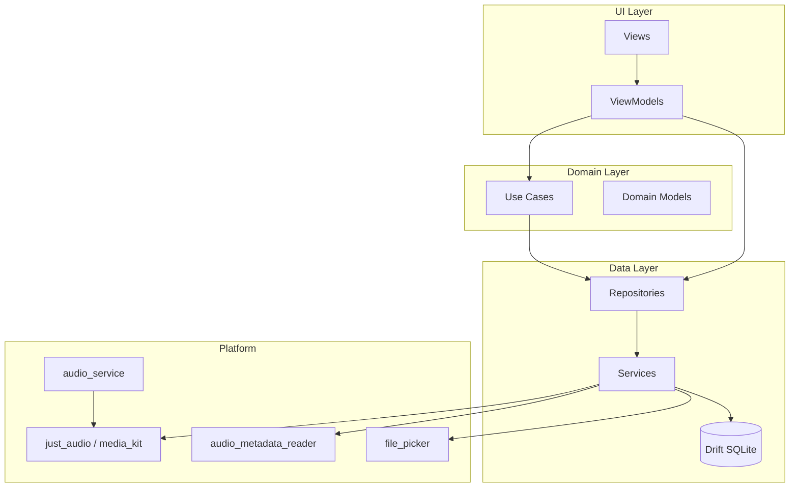
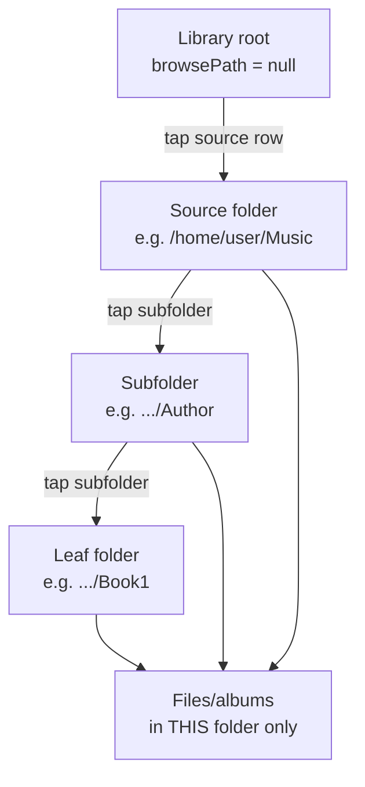
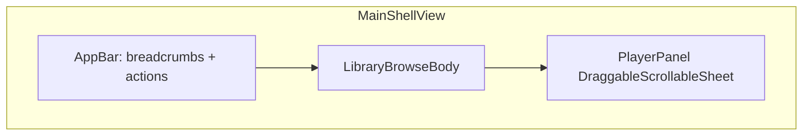
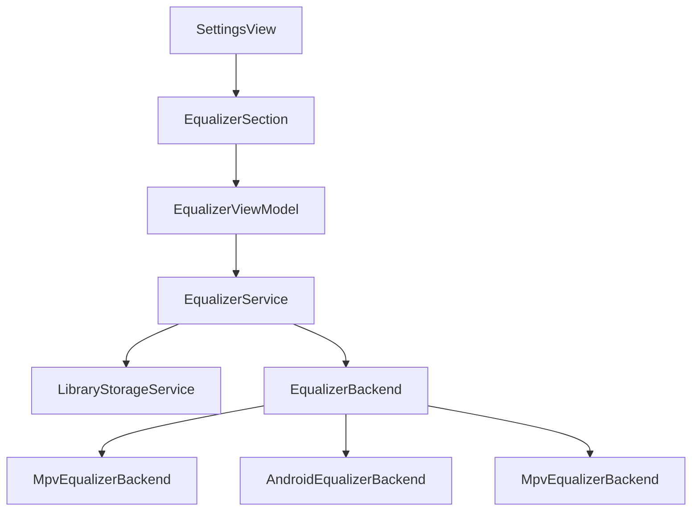
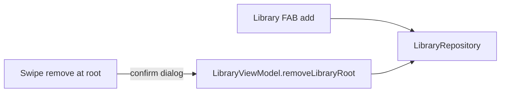

# Retro Player — Development Plan

Merged plan covering the original greenfield roadmap, library browse UX, playback persistence, and Linux playback fixes. Updated from implementation work and chat requirements (July 2026).

> **Superseded parts (Oct 2026 refactor):** manual drag-and-drop ordering, the
> saved main tab and `AudioFilePickerService` were removed. The app is a
> read-only front end over the folder tree; only app-created playlists are
> written. Current behaviour lives in [REQUIREMENTS.md](REQUIREMENTS.md).

---

## Todos

### Original phases (scaffold → hardening)

| ID | Task | Status |
|----|------|--------|
| `scaffold` | Phase 0: Flutter project scaffold, Drift schema v1, CI with analyze + test | **Completed** |
| `grouping-tdd` | Phase 1a: TDD `GroupTracksIntoAlbums` (tags + directory heuristics) | **Completed** |
| `scan-metadata` | Phase 1b: MetadataService, FileScanService, ScanLibrary, library UI | **Completed** |
| `playback` | Phase 2: just_audio + audio_service, gapless queue, resume positions | **Partial** — resume fixed with stable IDs; verify on device |
| `sort-dnd` | Phase 3: Metadata sort modes + ReorderableListView manual order | **Completed**, manual order removed in Oct 2026 |
| `platform` | Phase 4: Android/iOS permissions, Linux media_kit + MPRIS, integration tests | **Partial** — Linux needs system `libmpv`; integration test is shell-only |
| `hardening` | Phase 5: Coverage, error UX, README format matrix + privacy | **Partial** — README done; full doc set pending (see Documentation section) |

### UX and playback (from chat)

| ID | Task | Status |
|----|------|--------|
| `mobile-first-layout` | Phone-sized UI on Linux/desktop (`MobileLayout`, 430×920 window) | **Completed** |
| `mini-player-progress` | Seekable progress bar in mini player on Library/Settings tabs | **Completed** |
| `player-transport` | Play/pause, skip prev/next, title/duration; tap/long-press/double-tap to play | **Completed** |
| `remove-stop-button` | Remove redundant stop button from full Player tab | **Completed** |
| `directory-up` | Up control in library app bar to leave current folder | **Completed** |
| `play-entire-folder` | Play all tracks under a folder recursively (▶ on folder row) | **Completed** |
| `persistence-aggressive-save` | Save progress every 10s while playing, on pause/seek/skip, app background, dispose | **Completed** — saves run but resume fails until stable IDs are fixed |

### Library browse (correct file-browser semantics)

| ID | Task | Status |
|----|------|--------|
| `browse-root-sources-only` | Top-level library shows only added source folders; no flat audio list at root | **Completed** |
| `browse-strict-one-level` | Each directory: immediate subfolders + files/albums directly in that folder only | **Completed** |
| `browse-path-normalize` | Normalize all browse/compare paths consistently (Linux path mismatches) | **Completed** |
| `browse-widget-tests` | Widget tests: root sources, `browseInto` shows subfolders + visible file rows | **Completed** |
| `browse-unit-tests` | Rewrite `browse_library_test.dart` with requirement-driven + negative cases | **Completed** |

### Persistence and Linux playback fixes

| ID | Task | Status |
|----|------|--------|
| `stable-track-album-ids` | Stable track ID from `filePath`; album ID from `groupingKey` (not UUID per scan) | **Completed** |
| `persistence-resume-fix` | Save/load by `filePath`; resume in `playTrack`; unify PlayAlbum/PlayFolder lookup | **Completed** |
| `persistence-integration-test` | Integration test: play → save → rescan/restart → resume from saved position | **Completed** |
| `persistence-manual-verify` | Document Linux manual persistence verification (DB path + quit/relaunch) | **Partial** — README summary; full manual test doc pending |
| `linux-mpv-seek-fix` | Use `initialPosition` in `setAudioSources`; remove post-load seek race on Linux | **Completed** |

### Documentation

| ID | Task | Status |
|----|------|--------|
| `doc-architecture` | Full architectural documentation (layers, data flow, domain model, persistence, platform) | **Completed** — [`doc/ARCHITECTURE.md`](ARCHITECTURE.md) |
| `doc-usage` | Usage documentation / user manual (library, browse, play, settings, supported formats) | **Pending** |
| `doc-manual-testing` | Manual test documentation (test cases, steps, expected results, persistence verification) | **Pending** |
| `doc-automated-testing` | Automated test documentation (test layout, how to run, CI, coverage, writing new tests) | **Completed** — [`doc/AUTOMATED_TESTING.md`](AUTOMATED_TESTING.md) |
| `doc-index` | `doc/README.md` index linking all docs; README points to `doc/` | **Pending** |

### Keyboard UX and platform (July 2026 batch)

| ID | Task | Status |
|----|------|--------|
| `kb-settings-tab` | Settings: remove ↑/↓ row nav; Tab/focus only for segments, sliders, subpages | **Completed** |
| `kb-library-tab` | Library/tree: Tab order row → ▶ → next row; keep ↑/↓ fast row hop + focus sync | **Completed** |
| `kb-playlist-tab` | Playlist detail: Tab through entries; keep ↑/↓ fast entry hop | **Completed** |
| `kb-player-tab` | Expanded + collapsed player: Tab seek → transport → speed | **Completed** |
| `kb-sort-escape` | Sort menu: Ctrl+Shift+S; Escape dismisses popup before other actions | **Completed** |
| `kb-tree-path` | Tree view: switching from subfolder expands to current path (not library root) | **Completed** |
| `db-drop-catalog` | Remove unused Drift `albums`/`tracks` tables (PoC; no migration) | **Completed** |
| `platform-mpris-linux` | Linux OS media keys via `audio_service_mpris` + handler metadata sync | **Completed** |
| `kb-docs` | Update ARCHITECTURE + keyboard tables; drop context-menu references | **Completed** |

### Keyboard focus sync (July 2026)

| ID | Task | Status |
|----|------|--------|
| `kb-focus-split-shortcuts` | Split global vs list-navigation shortcuts; remove Enter/Space from `AppShortcuts` | **Completed** |
| `kb-focus-library-sync` | Library row focus registry + VM→focus sync on ↑/↓ / Home / End / parent restore | **Completed** |
| `kb-focus-settings-2d` | Settings `SettingsFocusScope` + line registry; ↑/↓ line hop; native Enter/Space | **Completed** |
| `kb-focus-playlist-sync` | Playlist detail scoped list shortcuts + arrow→focus sync | **Completed** |
| `kb-focus-autofocus` | Stop `AppShortcuts` from stealing focus after navigation/rebuild | **Completed** |
| `kb-focus-tests` | Settings + library keyboard integration tests; scoped shortcut regression | **Completed** |

### Keyboard focus polish (July 2026)

| ID | Task | Status |
|----|------|--------|
| `library-play-focus` | Single Tab stop on ▶; Enter/Space always play | **Completed** |
| `library-focus-restore` | Post-frame focus restore after Backspace; row register in build; AppShortcuts policy | **Completed** |
| `panel-toggle-focus` | Retain focus on expand/collapse after toggle | **Completed** |
| `settings-tab-trap` | Remove per-line FocusScope; visible slider focus; Tab cross-line; pointer sync | **Completed** |
| `player-tab-order` | Breadcrumb → art → title → seek → transport → speed | **Completed** |
| `keyboard-tests-docs` | Library/settings/player keyboard tests; docs updated | **Completed** |

**Library:** one Tab stop per row (body → ▶); Enter/Space on ▶ always plays; Backspace parent restores row body focus (not AppBar).

**Player (expanded):** explicit tab order — breadcrumb segments → album art → title → seek → prev/play/next → speed; visible focus rings on art/title.

**Settings:** Tab crosses lines (no per-line FocusScope trap); slider rows show accent border when focused; pointer click syncs ↑/↓ line index.

**Implementation:** [`library_row_focus.dart`](../lib/ui/core/keyboard/library_row_focus.dart), [`app_shortcuts.dart`](../lib/ui/core/keyboard/app_shortcuts.dart), [`settings_focus.dart`](../lib/ui/features/settings/widgets/settings_focus.dart), [`player_focus.dart`](../lib/ui/features/player/widgets/player_focus.dart), [`main_shell_view.dart`](../lib/ui/core/main_shell_view.dart).

**Unified 2D focus model:** ↑/↓ moves vertically (library row, playlist entry, or Settings line). Tab / Shift+Tab moves horizontally within the current line and wraps at end-of-line. Library/playlist keep highlight and focus in sync after arrow moves. Settings uses native widget activation (Enter/Space) because list shortcuts are not mounted on Settings.

**Implementation:** `lib/ui/core/keyboard/` (`list_navigation_shortcuts.dart`, `library_row_focus.dart`, `settings_focus_registry.dart`, `settings_focus.dart`); library VM `attachRowFocusRegistry` / `_syncKeyboardFocus`; [`settings_view.dart`](../lib/ui/features/settings/views/settings_view.dart) line wrappers.

**Dropped:** context menus (right-click / long-press on library rows).

**Unified input model:**

| Mechanism | Settings | Library / tree | Playlist | Player (expanded/collapsed) |
|-----------|----------|----------------|----------|----------------------------|
| Tab | Segments, sliders, links | Row body → ▶ (one stop) → next row | Entry → actions | Breadcrumb → art → title → seek → transport → speed |
| ↑ / ↓ | Line hop (theme → language → EQ → subpages) | Fast row hop + focus sync | Fast entry hop + focus sync | — |
| ←/→ | Adjust focused control | When focused | When applicable | Adjust seek/speed slider |
| Escape | Leave subpage / Settings | Dismiss popups; collapse player | Close detail | Collapse player |

See [Key navigation](#key-navigation-desktop--linux--windows--macos) below for shortcut tables.

### Retro iPod-inspired layout

| ID | Task | Status |
|----|------|--------|
| `retro-tokens-theme` | Design tokens (`retro_colors`, `retro_spacing`, `retro_typography`) + `AppTheme` silver/chrome palette | **Completed** |
| `retro-player-widgets` | `AlbumArtFrame`, `RetroProgressBar`, `RetroTransportControls` | **Completed** |
| `retro-player-screen` | PlayerView hero layout (centered art, mono times, tactile transport) | **Completed** |
| `retro-app-shell` | `MobileLayout` device bezel, `MobileShell` nav chrome, `MiniPlayerBar` strip | **Completed** |
| `retro-library-lists` | `RetroListTile`; library/album detail list styling | **Completed** |
| `retro-tests-polish` | Widget test updates; golden tests optional | **Completed** |

*Note: `persistence-manual-verify` will be fulfilled as part of `doc-manual-testing` (and summarized in `doc/USAGE.md`).*

---

## Product requirements (consolidated)

### Core product

- **Local-only** audio player for music and audiobooks (Android, iOS, Linux).
- **Test-driven**, open-source dependencies only; **no ads, telemetry, or monetization**.
- **Simple UI**: form-follows-function layout with iPod-inspired silver/chrome styling — not skeuomorphic click-wheel hardware.
- **P0 formats** on all platforms: MP3, M4A, M4B, FLAC, WAV.
- **OGG/Opus**: Android and Linux only; **out of scope on iOS**.
- **Audiobook grouping**: directory and metadata heuristics (`GroupTracksIntoAlbums`).
- **Sorting**: metadata modes + drag-and-drop manual order persisted in SQLite.
- **Gapless album playback**, speed control, background/system media controls.

### Library UX (file browser)

1. **Top-level library page** shows only **selected library sources** (folders added via “Add folder”) — not the entire audio library flattened.
2. **Navigate like a Linux file manager**: one directory level at a time; **Up** returns to the parent.
3. At each level show:
   - **Immediate subfolders** that contain audio (one level deep only).
   - **Files/albums whose tracks live directly in the current directory** — not content from deeper subfolders listed at the parent.
4. **Too confusing to avoid**: listing all folders that contain audio anywhere in the tree at the top level, or showing the full library flat at root.
5. **Play entire folder** from the folder row (▶) without opening the folder first; **tap row** to browse into it.

### Playback and persistence

- **Persistence is critical** for acceptance: last played file and position must survive app restart.
- Save triggers (already implemented): every **10 seconds** while playing, pause, seek, skip, speed change, track change, app background/hidden, ViewModel dispose.
- **Known gap**: resume after cold start fails because scan assigns new UUIDs each launch; fix with stable IDs keyed by `filePath` / `groupingKey`.
- **Manual test**: full quit (`q` in `flutter run`), not hot restart (`R`); relaunch and replay same album/folder.

### Player UX

- Mini player on Library/Settings with transport controls and **seekable progress bar**.
- Full Player tab: previous · play/pause · next (**no stop button**).
- Tap/long-press library item to play; double-tap album opens detail + plays.

### Linux desktop

- **Mobile-first frame** even on desktop (centered ~430px wide).
- Requires system **libmpv** (`mpv` / `mpv-libs` on Fedora).
- **MPV errors** (`lavf: Failed to create file cache`, `seek 0.0000`) — fix by passing `initialPosition` at load time instead of seeking before MPV is ready.

---

## Goals and constraints

| Requirement | Approach |
|-------------|----------|
| Test-driven | Red → Green → Refactor; domain `test` + `mockito`; UI `flutter_test`; flows `integration_test` |
| Open source only | MIT / BSD / Apache-2.0 packages |
| No ads / monetization | No ad SDKs, IAP, or analytics |
| Security | CI analyze + dependency checks; minimal Android permissions (`Permission.audio`) |
| Simple UI | iPod-inspired silver/chrome theme; Library / Player / Settings tabs; mini player |
| Cross-platform | Android + iOS + Linux from day one |

---

## Audio format support matrix

| Format | Priority | Android | iOS | Linux | Notes |
|--------|----------|---------|-----|-------|-------|
| MP3 | P0 | Yes | Yes | Yes | ID3 tags |
| M4A/AAC | P0 | Yes | Yes | Yes | ILST tags |
| M4B | P0 | Yes | Yes | Yes | Audiobooks |
| FLAC | P0 | Yes | Yes | Yes | First-class from day one |
| WAV | P0 | Yes | Yes | Yes | Limited tags |
| OGG/Opus | P2 | Yes | **No** | Yes | Out of scope on iOS |
| AIFF | P2 | Yes | Yes | Yes | Defer |
| WMA/APE | P3 | — | — | — | Future |

---

## Selected stack

| Area | Package | Role |
|------|---------|------|
| Playback | `just_audio` | Gapless playlists, speed, queue |
| Linux playback | `just_audio_media_kit` | libmpv backend on Linux |
| Background | `audio_service`, `audio_session` | Lock screen, headset, ducking |
| Linux MPRIS | `audio_service_mpris` | Desktop media keys |
| Metadata | `audio_metadata_reader` | Pure Dart tag reading |
| Files | `file_picker`, `path_provider` | Folder pick, app DB path |
| Permissions | `permission_handler` | Android audio permission |
| Persistence | `drift` | SQLite: roots, sort order, playback state |
| UI / DI | `provider`, `go_router`, `freezed` | MVVM, routing, models |

Linux note: `media_kit` does not bundle libmpv on Linux; install `mpv` / `mpv-devel` on the system.

---

## Architecture



### Directory layout

```
lib/
├── data/db/                    # Drift tables
├── data/services/              # playback, scan, metadata, storage
├── data/repositories/
├── domain/models/
├── domain/use_cases/           # scan, group, sort, browse, play_album, play_folder
└── ui/features/                # library, album_detail, player, settings
test/                           # mirrors lib/
integration_test/
doc/
├── DEVELOPMENT_PLAN.md         # this file — roadmap and todos
├── README.md                   # index of all documentation (planned)
├── ARCHITECTURE.md             # C4 diagrams, call chains, test coverage map
├── README.md                   # doc index
├── USAGE.md                    # user manual / usage guide (planned)
├── MANUAL_TESTING.md           # manual test cases and procedures (planned)
└── AUTOMATED_TESTING.md        # automated test guide and CI (planned)
```

---

## Domain: audiobook / directory grouping

`GroupTracksIntoAlbums` rules (priority order):

1. **Album tag match** — same non-empty `album` metadata → one `AudioAlbum`
2. **Leaf directory** — 2+ files in same directory → album titled from tags or directory name
3. **Series directories** — parent with multiple chapter subdirs → album per subdir
4. **Loose files** — single ungrouped file → `LibraryTrackItem`

Display title: album tag → directory name → filename.

**Planned ID fix:** album `id` = stable `groupingKey`; track `id` = normalized `filePath`.

---

## Library browse model (target)



| Level | Folders shown | Items shown |
|-------|---------------|-------------|
| Root (`null`) | Added library roots only | **None** |
| Inside source/subdir | Immediate child dirs with audio | Tracks/albums with `directoryPath == current` only |
| Any level | ▶ on folder = play all tracks under that path recursively | Tap item = play album/track |

**Current implementation gaps** ([`browse_library.dart`](../lib/domain/use_cases/browse_library.dart)):

- Root incorrectly sets `items: allItems` (flat entire library).
- `_albumAtPath` shows albums at parent when all tracks live in one child folder (violates one-level rule).

---

## Sorting

| Layer | Persistence |
|-------|-------------|
| Default sort mode (title, artist, album, date, track #, duration) | `app_settings` |
| Manual drag order per browse path | `sort_orders` keyed by `library:{path}` |

Manual order overrides metadata sort when present.

---

## Playback persistence

### Schema (`playback_states`)

| Column | Purpose |
|--------|---------|
| `itemId` | Album `groupingKey`, `folder:{path}`, or track `filePath` |
| `trackId` | **Should store `filePath`** (currently volatile UUID — bug) |
| `positionMs` | Position in track |
| `speed` | Playback speed |

### Save triggers (implemented)

- Every 10 seconds while playing
- Pause, seek, skip, speed change
- Track auto-advance
- App lifecycle paused/hidden/detached
- ViewModel dispose

### Resume flow (target)

1. User plays album/folder/track → `_currentItemId` set
2. Progress saved to SQLite with stable keys
3. On relaunch: rescan library (stable IDs match saved rows)
4. `PlayAlbum` / `PlayFolder` / `playTrack` read state → `initialIndex` + `initialPosition`

### Manual verification (Linux)

Detailed steps belong in [`doc/MANUAL_TESTING.md`](MANUAL_TESTING.md) (planned). Summary:

1. Play ~30s, pause (or wait for periodic save)
2. Quit app fully (`q`), not hot restart
3. Relaunch, play same item → should resume mid-track
4. Inspect DB: `retroplayer.db` under app documents dir (often `~/.local/share/app.retroplayer/` or `~/Documents/`)
   ```bash
   sqlite3 retroplayer.db "SELECT * FROM playback_states;"
   ```

User-facing persistence notes will also appear in [`doc/USAGE.md`](USAGE.md).

---

## Linux MPV errors

Symptoms in terminal:

```
MPV: [error] lavf: Failed to create file cache.
MPV: [error] media_kit: error: error running command _command(seek, 0.0000, absolute)
```

**Cause:** `seek()` immediately after `setQueue()` before MPV demuxer is ready ([`play_album.dart`](../lib/domain/use_cases/play_album.dart), [`play_folder.dart`](../lib/domain/use_cases/play_folder.dart)).

**Fix:**

```dart
await _player.setAudioSources(
  sources,
  initialIndex: index,
  initialPosition: position ?? Duration.zero,
);
// Do not call seek() separately for initial resume
```

---

## Feature phases (original + status)

### Phase 0 — Scaffold — **Completed**

- Flutter project, Drift v1, CI, `go_router` shell

### Phase 1 — Library scan and metadata — **Completed**

- Scan, metadata, grouping, library UI, add folder

### Phase 2 — Playback — **Partial**

| Done | Remaining |
|------|-----------|
| just_audio queue, gapless, speed | Stable IDs + working resume |
| PlayAlbum, PlayFolder, playTrack | `initialPosition` Linux fix |
| audio_service handler | Full integration test for play → save → resume |
| Mini + full player UI | — |

### Phase 3 — Sorting and DnD — **Completed**

- Sort modes, ReorderableListView, per-path manual order

### Phase 4 — Platform polish — **Partial**

| Done | Remaining |
|------|-----------|
| Android permissions, Linux media_kit init | Document libmpv install |
| Mobile shell, bottom nav | Persistent iOS security-scoped URLs (if needed) |
| Basic integration test | Browse + persistence integration tests |

### Phase 5 — Hardening — **Partial**

| Done | Remaining |
|------|-----------|
| README formats + privacy | Persistence verification in README |
| Unit/widget tests (26+) | Browse widget tests, persistence integration test |
| CI workflow | Optional coverage gate |

---

## UI screens

```
┌─────────────────────┐     ┌─────────────────────┐     ┌─────────────────────┐
│  Library            │     │  (inside folder)    │     │  Player             │
│  Sources:           │     │  ↑ Up               │     │  Title / seek bar   │
│  📁 /home/Music  ▶  │────▶│  📁 Author      ▶   │────▶│  ◀◀  ▶  ▶▶         │
│  📁 /data/Books   ▶  │     │  📁 Book1       ▶   │     └─────────────────────┘
└─────────────────────┘     │  🎵 loose.mp3       │
                            │  💿 Book One (album)│
                            └─────────────────────┘
```

- Bottom nav: Library | Player | Settings
- Mini player above tabs on Library/Settings
- Settings: library roots management

---

## Retro iPod-inspired layout (July 2026)

Evolve the generic Material 3 UI into an **iPod-inspired** look: silver/grey chrome, centered album art, tactile transport controls, and monospace time display — **without a click wheel** or full skeuomorphic hardware chrome.

### Design direction

| Element | Target |
|---------|--------|
| Palette | Light silver body, white screen panels, graphite text, iPod-classic blue accent (`#007AFF`) |
| Typography | Condensed sans for titles; tabular monospace for elapsed/total time |
| Album art | Square frame (~240px) with inner border; placeholder until embedded art exists |
| Controls | Circular tactile buttons; larger center play/pause |
| Desktop frame | Metallic gradient bezel in `MobileLayout` letterbox |

Retro feel comes from **palette, typography, spacing, and component shapes** — not fake plastic everywhere. Navigation, persistence, and ViewModel logic stay unchanged.

### Implementation phases

1. **Tokens + theme** — `lib/ui/core/retro/` + [`lib/ui/core/theme.dart`](../lib/ui/core/theme.dart)
2. **Player widgets** — `AlbumArtFrame`, `RetroProgressBar`, `RetroTransportControls`
3. **Player screen** — [`lib/ui/features/player/views/player_view.dart`](../lib/ui/features/player/views/player_view.dart)
4. **App shell** — `MobileLayout`, `MobileShell`, `MiniPlayerBar`
5. **Library lists** — `RetroListTile`, library/album detail styling
6. **Tests** — update widget finders; run `flutter test`

### Out of scope

- Click wheel / rotary input
- Embedded album art extraction (placeholder frame only)
- Changing routing or persistence logic

---

## Test plan

See [`doc/AUTOMATED_TESTING.md`](AUTOMATED_TESTING.md) (planned) for the full automated testing guide. Manual procedures: [`doc/MANUAL_TESTING.md`](MANUAL_TESTING.md) (planned).

### Existing coverage

- `group_tracks_into_albums_test.dart`, `sort_library_test.dart`, `play_album_test.dart`, `play_folder_test.dart`
- `browse_library_test.dart` — **needs rewrite** (root-items test contradicts spec)
- `library_view_test.dart` — empty state only
- `integration_test/app_test.dart` — shell only; stale empty-state string

### Required new/updated tests

| Test | Asserts |
|------|---------|
| `browse_library_test.dart` | Root: sources only, zero items; strict one-level items; no parent album shortcut |
| `library_view_test.dart` | Sources visible at root; after `browseInto`, subfolder + file rows visible |
| `persistence_resume_test.dart` | Scan → save → rescan → resume position |
| `integration_test` | File-backed DB, cold-start resume |
| `audio_playback_service` / play use cases | `initialPosition` passed, no post-load seek on start |

### TDD workflow

1. Write failing test for domain/UI contract
2. Implement minimum fix
3. `dart analyze` + `flutter test`
4. Refactor

---

## Documentation plan

All project documentation lives under [`doc/`](.). The root [`README.md`](../README.md) stays a short entry point (features, privacy, build commands) and links into `doc/` for detail.

### Deliverables

| Document | Audience | Contents |
|----------|----------|----------|
| [`doc/ARCHITECTURE.md`](ARCHITECTURE.md) | Developers | Layered MVVM overview; package/stack choices; directory layout; domain models; use-case map; data flow (scan → group → browse → play); Drift schema and persistence model; platform adapters (Android/iOS/Linux, libmpv); routing and state (Provider/ViewModels); extension points |
| [`doc/USAGE.md`](USAGE.md) | End users | First run; adding library folders; browsing like a file manager; playing albums, tracks, and folders; player controls; speed and resume behavior; Settings; supported formats; Linux libmpv requirement; troubleshooting |
| [`doc/MANUAL_TESTING.md`](MANUAL_TESTING.md) | QA / developers | Manual test matrix by feature; step-by-step cases with expected results; persistence verification (quit/relaunch, DB inspection); platform-specific checks (Android permissions, Linux MPV); regression checklist before release |
| [`doc/AUTOMATED_TESTING.md`](AUTOMATED_TESTING.md) | Developers | Test pyramid (unit / widget / integration); folder layout mirroring `lib/`; how to run tests and coverage; CI pipeline; mocking conventions; TDD workflow; how to add tests for new use cases and screens; fixture strategy |
| [`doc/README.md`](README.md) | All | Table of contents linking the above + this development plan |

### Documentation todos (detail)

**`doc-architecture`** — **Completed** ([`doc/ARCHITECTURE.md`](ARCHITECTURE.md))
- C4 L1–L4, use-case call chains, input modalities
- Planned: OS media keys via `MediaTransportBridge` (§11.1)
- File deletion policy: never delete user files except app-created playlists (§5)
- `albums`/`tracks` catalog schema retained (§5)

**`doc-usage`**
- Write task-oriented sections matching the file-browser UX spec
- Include screenshots or ASCII UI maps when stable
- Cross-link format matrix from README

**`doc-manual-testing`**
- One section per feature area (library, browse, play, persistence, sort, settings)
- Include persistence cold-start procedure (supersedes standalone `persistence-manual-verify` content)
- Mark platform-specific cases (Linux / Android / iOS)

**`doc-automated-testing`** — **Completed** ([`doc/AUTOMATED_TESTING.md`](AUTOMATED_TESTING.md))
- Test pyramid, layout, run commands, conventions
- Coverage by use case; touch/gesture requirements (manual matrix alone is not sufficient)
- Priority backlog including context menus and OS media keys

**`doc-index`**
- Create `doc/README.md`
- Add “Documentation” section to root README linking to `doc/README.md`

### When to write

| Priority | Docs | Rationale |
|----------|------|-----------|
| After stable IDs + browse fix | USAGE, MANUAL_TESTING (persistence section) | Document behavior that actually works |
| In parallel with browse/persistence work | AUTOMATED_TESTING | Encode test conventions as tests land |
| After major features stabilize | ARCHITECTURE | **Done** — see [`ARCHITECTURE.md`](ARCHITECTURE.md) |
| Before first public release | Full set + doc index | Complete operator and contributor docs |

---

## Security and privacy

- No network permissions
- No analytics or crash reporters in v1
- User-initiated folder access only
- `dart analyze` in CI; dependency updates via Dependabot

---

## Implementation priority (next work)

1. **Stable IDs** — unblocks persistence (highest user impact)
2. **Browse semantics** — root sources only + strict one-level items
3. **Tests** — encode requirements before further UI tweaks
4. **Linux MPV** — `initialPosition` in `setAudioSources`
5. **Integration test** — end-to-end resume
6. **Documentation** — USAGE + MANUAL_TESTING after persistence fix; AUTOMATED_TESTING in parallel; ARCHITECTURE when structure stabilizes

### Primary files (code)

| File | Change |
|------|--------|
| `lib/domain/use_cases/browse_library.dart` | Strict one-level browse; root sources only |
| `lib/domain/use_cases/scan_library.dart` | Stable track IDs |
| `lib/domain/use_cases/group_tracks_into_albums.dart` | Stable album IDs |
| `lib/domain/use_cases/play_album.dart` | Resume by filePath; no post-load seek |
| `lib/domain/use_cases/play_folder.dart` | Same |
| `lib/data/services/audio_playback_service.dart` | `initialPosition` in setQueue |
| `lib/ui/features/library/views/library_view.dart` | “Library sources” section at root |
| `test/domain/use_cases/browse_library_test.dart` | Requirement-driven tests |
| `test/ui/features/library/library_view_test.dart` | Folder + file visibility |
| `integration_test/app_test.dart` | Persistence flow |

### Primary files (documentation)

| File | Change |
|------|--------|
| `doc/ARCHITECTURE.md` | Full architectural reference |
| `doc/USAGE.md` | User manual |
| `doc/MANUAL_TESTING.md` | Manual test cases + persistence verification |
| `doc/AUTOMATED_TESTING.md` | Automated test and CI guide |
| `doc/README.md` | Documentation index |
| `README.md` | Short link to `doc/` |

---

## Recommended first TDD cycle (remaining work)

1. **Red:** `browse_library_test` — root has sources, `items` is empty
2. **Green:** Fix `BrowseLibrary` root branch + remove `_albumAtPath` shortcut
3. **Red:** `persistence_resume_test` — save after play, rescan, assert resume
4. **Green:** Stable IDs + filePath in `savePlaybackState`
5. **Red:** widget test — `browseInto` shows album title
6. **Green:** Path normalization + UI if needed
7. **Red:** play_album test — `initialPosition` used, no seek on load
8. **Green:** `JustAudioPlaybackService.setQueue` update

---

*Last updated: July 2026 — merged from original greenfield plan, library browse/persistence plan, documentation plan, and unified library+player shell refactor.*

---

## Unified Library + Player shell (July 2026)

Merge the Library and Player tabs into a **single main screen** with a draggable player panel at the bottom. Remove the bottom tab bar; move Settings to a gear icon in the AppBar.

### Problem (breadcrumb bug)

When album detail was open, user played a track, switched to Player, then tapped a **folder** breadcrumb, the app returned to Library still showing **album detail** because:

1. The library branch stack retained `/album-detail` when switching tabs (`StatefulShellRoute.indexedStack`).
2. Folder breadcrumb navigation did not explicitly pop album detail or clear `library_album_detail_id`.

### Target UX

| State | Library body | AppBar | Player panel |
|-------|-------------|--------|--------------|
| **Collapsed** | Visible | Browse breadcrumbs + tree/sort/settings/player-toggle | Mini bar: art, title, seek, transport |
| **Expanded** | Hidden | Playback breadcrumbs only | Full player: art, title, transport, speed |
| **Interaction** | Normal browse | Settings → `/settings` push | Swipe up/down + AppBar toggle |

On **play from library**: start playback + expand player panel.

### Architecture



### Implementation todos

| ID | Task | Status |
|----|------|--------|
| `unified-close-album-detail` | `closeAlbumDetail()`; folder breadcrumbs never open album | **Completed** |
| `unified-player-panel` | `PlayerPanelViewModel` + `PlayerPanel` + `NowPlayingContent` | **Completed** |
| `unified-main-shell` | `MainShellView` replaces `MobileShell` + tab bar | **Completed** |
| `unified-router` | Single `/` route; `/settings` push; remove `/player` tab | **Completed** |
| `unified-play-expand` | Play from library expands panel | **Completed** |
| `unified-tests` | Breadcrumb regression + panel widget tests | **Completed** |

### Player locate, volume, equalizer (July 2026)

Three playback UX features planned after the unified shell refactor.

#### 1. Tap-to-locate (`jump-to-playing`)

**Goal:** Tap title or album art in the mini or expanded player to jump to the playing track in the library.

**Flow:**

1. User taps title/art in `PlayerCollapsedBar` or `PlayerExpandedBody` (drag handle still expands/collapses only).
2. `LibraryViewModel.jumpToNowPlaying()`:
   - `closeAlbumDetail()` if album detail is open
   - `navigateToBrowsePath(track.directoryPath)` without clearing highlight
   - Collapse expanded player via `onCollapsePlayer`
   - Open album detail when `playingItemId` is an album (`router.push` album detail)
   - Set `highlightedTrackId` on the playing track
3. `LibraryItemTile` highlights loose tracks via `highlightedTrackId`.
4. `AlbumDetailView` scrolls to and highlights the track row (`Scrollable.ensureVisible`).
5. Breadcrumb tap on track segment reuses `jumpToNowPlaying`.
6. Highlight clears on manual browse (`browseInto`, `browseUp`, folder breadcrumbs, add/remove root).

**Files:** `library_view_model.dart`, `player_panel.dart`, `library_item_tile.dart`, `album_detail_view.dart`

#### 2. Volume (removed)

In-app volume was removed in favor of **device/system volume only**. just_audio stays at default gain (1.0); hardware keys and the OS mixer control loudness.

#### 3. Equalizer Phase A (settings UI)

**Goal:** Preset picker in Settings; persist choice; show unsupported note until Phase B.

**Presets:** Off, Bass boost, Treble boost, Voice (podcast) — stored as `equalizer_preset` in `app_settings`.

**Phase B (Linux):** MPV `af` equalizer filters via vendored `just_audio_media_kit`; `EqualizerService` applies preset on startup and when changed in Settings.

**Files:** `equalizer_preset.dart`, `equalizer_service.dart`, `library_storage_service.dart`, `settings_view.dart`, `packages/just_audio_media_kit/`

### Implementation todos

| ID | Task | Status |
|----|------|--------|
| `dock-gap-fix` | Remove duplicate bottom padding in `PlayerDockShell` | **Completed** |
| `jump-to-playing` | Tap mini/expanded title → browse folder, open album, highlight track | **Completed** |
| `volume-slider` | Removed — use device/system volume only | **Removed** |
| `eq-phase-a` | Settings equalizer presets + persistence | **Completed** |
| `eq-phase-b` | Linux mpv equalizer via `JustAudioMediaKit.applyAudioFilter` | **Completed** |

### Key files

| File | Change |
|------|--------|
| `lib/ui/features/library/view_models/library_view_model.dart` | `jumpToNowPlaying`, `highlightedTrackId` |
| `lib/ui/features/player/widgets/player_panel.dart` | `locateNowPlaying` |
| `lib/data/services/equalizer_service.dart` | Apply MPV `af` filter from saved preset |
| `lib/domain/models/equalizer_preset.dart` | Preset enum + `mpvAudioFilter` chains |
| `packages/just_audio_media_kit/` | `applyAudioFilter`, apply on player init/load |
| `lib/ui/features/settings/views/settings_view.dart` | Equalizer radio list |
| `lib/ui/features/album_detail/views/album_detail_view.dart` | Scroll-to-highlight |

---

## Cross-platform equalizer (July 2026)

Evolve Linux-only MPV presets into simple + advanced EQ on **Linux, Android, and iOS**.

### Architecture



| Platform | Backend | Notes |
|----------|---------|-------|
| Linux | MPV `af` via vendored `just_audio_media_kit` | Existing path; custom bands via `EqualizerFilterBuilder` |
| Android | `android.media.audiofx.Equalizer` + MethodChannel | Uses `just_audio` `androidAudioSessionId` |
| iOS | MPV `af` via `just_audio_media_kit` | `ensureInitialized(iOS: true)` in `main.dart` |

### Domain model

- **5 bands:** 60 / 230 / 910 / 3600 / 14000 Hz, gain −12…+12 dB
- **`EqualizerSettings`:** `mode` = off | preset | custom; preset or custom bands
- **`EqualizerFilterBuilder`:** settings → MPV `af` chain

### Storage (`app_settings`)

| Key | Value |
|-----|-------|
| `equalizer_mode` | `off` / `preset` / `custom` |
| `equalizer_preset` | preset name |
| `equalizer_bands` | JSON band gains |

Legacy `equalizer_preset`-only rows migrate to `mode=preset` on load.

### UI

- **Inline on Settings** — presets and band sliders on [`settings_view.dart`](../lib/ui/features/settings/views/settings_view.dart) via [`equalizer_section.dart`](../lib/ui/features/settings/widgets/equalizer_section.dart)
- **Settings order:** About (with supported formats) → Equalizer
- Tree-view toggle removed from Settings (still available in library AppBar)
- **Simple:** segmented Off / Bass / Treble / Voice (always visible)
- **Advanced:** 5 band sliders always visible below presets; any change → `mode=custom`; debounced apply

### Settings layout refactor (July 2026)

Merge the separate equalizer route into the main Settings screen.

| ID | Task | Status |
|----|------|--------|
| `settings-eq-inline` | Presets + band sliders on Settings page | **Completed** |
| `settings-reorder` | About → Equalizer section order | **Completed** |
| `settings-no-tree` | Remove tree-view toggle from Settings | **Completed** |
| `settings-eq-route-remove` | Delete `/settings/equalizer` route | **Completed** |

### Implementation todos

| ID | Task | Status |
|----|------|--------|
| `eq-domain` | `EqualizerSettings`, 5-band model, filter builder, storage migration | **Completed** |
| `eq-ui-simple` | Inline presets on Settings page | **Completed** |
| `eq-ui-advanced` | Band sliders always visible on Settings page | **Completed** |
| `eq-backend-refactor` | `EqualizerBackend` strategy + `EqualizerService` | **Completed** |
| `eq-android` | `EqualizerPlugin.kt` + `AndroidEqualizerBackend` | **Completed** |
| `eq-ios` | `just_audio_media_kit` on iOS | **Completed** |
| `eq-device-qa` | Manual QA on Android/iOS devices | **Pending** |

### Key files

| File | Role |
|------|------|
| `lib/domain/models/equalizer_settings.dart` | Unified EQ state |
| `lib/domain/equalizer/equalizer_filter_builder.dart` | MPV filter strings |
| `lib/data/services/equalizer_service.dart` | Load/save/apply |
| `lib/data/services/equalizer/mpv_equalizer_backend.dart` | Linux + iOS |
| `lib/data/services/equalizer/android_equalizer_backend.dart` | Android MethodChannel |
| `android/.../EqualizerPlugin.kt` | Native Android EQ |
| `lib/ui/features/settings/widgets/equalizer_section.dart` | Inline EQ UI |
| `lib/ui/features/settings/views/settings_view.dart` | Settings layout |

### Out of scope

- Per-track EQ profiles, 10-band UI, spectrum analyzer, Windows support

---

## Library remove UX + equalizer layout (July 2026)

Move library folder management out of Settings and into the library screen. Simplify equalizer UI by always showing band sliders.

### Goals

1. **Settings** — About + Equalizer only (no Library section).
2. **Library** — add folder via FAB at root; remove via swipe-left on **library root sources only**, with confirmation dialog (files on disk are not deleted).
3. **Equalizer** — presets + band sliders always visible (remove Advanced toggle).

### Scope: swipe-remove only on library root sources

| Row type | Folder view | Tree view | Swipe remove? |
|----------|-------------|-----------|---------------|
| Library root source (added folder) | `browsePath == null` | `depth == 0` | **Yes** |
| Subfolder inside a library | `browsePath != null` | `depth > 0` | **No** |
| Audio / album items | `LibraryItemTile` | Leaf items | **No** |

### Flow



### Implementation todos

| ID | Task | Status |
|----|------|--------|
| `lib-remove-settings` | Remove Library section from Settings; delete `SettingsViewModel` | **Completed** |
| `lib-swipe-remove` | Swipe-left remove on root sources (folder + tree) with confirmation | **Completed** |
| `eq-bands-always` | Remove Advanced toggle; always show band sliders | **Completed** |
| `lib-remove-tests` | Widget tests for confirm/cancel/remove + subfolder not dismissible | **Completed** |

### Key files

| File | Change |
|------|--------|
| `lib/ui/features/settings/views/settings_view.dart` | About + Equalizer only |
| `lib/ui/features/settings/widgets/equalizer_section.dart` | Always-visible band sliders |
| `lib/ui/features/settings/view_models/equalizer_view_model.dart` | Remove `advancedExpanded` state |
| `lib/ui/features/library/widgets/library_remove_confirmation.dart` | Confirm dialog + `LibraryRootDismissible` |
| `lib/ui/features/library/views/library_view.dart` | Dismissible on root source rows |
| `lib/ui/features/library/widgets/library_tree_view.dart` | Dismissible on depth-0 nodes |

---

## Branding, color scheme, icon, and localization (July 2026)

Full product rename to **Retro Player** with a warm hi-fi **Studio Warm** palette, custom launcher icon, and Flutter gen-l10n (**en** + **de**).

### Scope

| Area | Value |
|------|--------|
| Display name | **Retro Player** |
| Dart package | `retroplayer` |
| App ID (Android/iOS/Linux) | `app.retroplayer` |
| DB filename | `retroplayer.db` |
| Notification channel id | `app.retroplayer` |

### Studio Warm palette

Warm parchment surfaces, amber VU-meter accent (`#C45C26`), deep teal secondary (`#2A6F6F`), warm ink text. Tokens in `lib/ui/core/retro/retro_colors.dart`; wired through `AppTheme.light()`.

### Icon

- Master: `assets/icon/app_icon.svg` — play + pause, transparent background, lighter amber (`#EDA066`); export PNGs via `scripts/generate_app_icon.py`
- Exported: `assets/icon/app_icon.png` (1024×1024) for `flutter_launcher_icons` and Linux bundle

### Localization

- `l10n.yaml`, `lib/l10n/app_en.arb` (template), `lib/l10n/app_de.arb`
- `flutter_localizations` + `intl`; `MaterialApp` delegates in `main.dart`
- UI strings in `lib/ui/**`; `SortMode` / `EqualizerPreset` labels via l10n
- Test helper: `test/helpers/pump_app.dart`

### Implementation todos

| ID | Task | Status |
|----|------|--------|
| `brand-colors` | Studio Warm palette in `retro_colors.dart` + `theme.dart` | **Completed** |
| `brand-icon` | App icon asset + `flutter_launcher_icons` + Linux icon | **Completed** |
| `brand-rename` | Full rename: package, app IDs, DB, notification channel, imports | **Completed** |
| `brand-l10n-setup` | gen-l10n infrastructure (en + de) | **Completed** |
| `brand-l10n-migrate` | Migrate UI strings + enum labels | **Completed** |
| `brand-tests` | TDD: color/theme/db/l10n tests; `flutter test` + Linux/Android builds | **Completed** |

### Key files

| File | Change |
|------|--------|
| `lib/app_branding.dart` | Central display name, app id, DB filename constants |
| `lib/data/db/database_path.dart` | DB path helper |
| `lib/ui/core/retro/retro_colors.dart` | Studio Warm tokens |
| `lib/l10n/app_en.arb`, `app_de.arb` | Localized strings |
| `pubspec.yaml` | `name: retroplayer`, l10n deps, launcher icons |
| `android/app/build.gradle.kts` | `app.retroplayer` |
| `linux/CMakeLists.txt` | `BINARY_NAME` / `APPLICATION_ID` |

### Manual QA

- Warm amber/teal UI (no `#007AFF` blue)
- Launcher icon + name **Retro Player**
- Settings/library/equalizer in **en** and **de**
- `retroplayer.db` on disk
- `flutter test`; `flutter build linux`; `flutter build apk`

---

## Settings polish batch (July 2026)

Follow-up after branding/dark-mode: OSS licenses, dark contrast, language picker, equalizer Manual fix, icon redesign, Linux taskbar icon.

### Equalizer Manual fix

The first preset segment was labeled **Off** but `EqualizerMode.custom` (slider tweaks) still highlighted **Off** in the UI. Rename to **Manual** (`EqualizerPreset.manual`); selecting Manual uses `EqualizerSettings.custom(flat)`; Bass/Treble/Voice stay presets. No legacy migration (app not released).

### Scope

| Area | Change |
|------|--------|
| OSS licenses | Settings → About → open-source licenses screen; root `LICENSE` |
| Dark mode | Lift Studio Night surfaces; stronger borders in dark theme |
| Language | Settings segmented control: English / Deutsch / System; persisted |
| Equalizer | `off` → `manual` enum + l10n; fix `selectedPreset` for custom mode |
| App icon | SVG master (play + pause, transparent, lighter amber); export PNGs |
| Linux taskbar | `gtk_window_set_icon_from_file`, bundle icon, `.desktop` + hicolor icons |

### Implementation todos

| ID | Task | Status |
|----|------|--------|
| `settings-oss-licenses` | OSS licenses screen + root LICENSE | **Completed** |
| `settings-dark-contrast` | Studio Night surface lift + dark borders | **Completed** |
| `settings-locale` | Locale preference persistence + Settings UI | **Completed** |
| `settings-eq-manual` | Equalizer Off → Manual rename + behavior | **Completed** |
| `settings-icon` | Icon redesign + platform regeneration | **Completed** |
| `settings-linux-icon` | Linux taskbar/window icon + `.desktop` | **Completed** |
| `settings-tests` | Tests + `flutter test` + Linux/Android builds | **Completed** |

### Key files

| File | Change |
|------|--------|
| `lib/ui/features/settings/views/settings_view.dart` | Appearance, Language, About, licenses link |
| `lib/domain/models/locale_preference.dart` | en / de / system |
| `lib/ui/features/settings/view_models/locale_view_model.dart` | Persisted locale |
| `lib/domain/models/equalizer_preset.dart` | `manual` replaces `off` |
| `lib/ui/core/retro/retro_palette.dart` | Dark surface tokens |
| `assets/icon/app_icon.svg` | SVG master (play + pause, transparent) |
| `assets/icon/app_icon.png` | Exported 1024 PNG for launcher icons |
| `linux/runner/my_application.cc` | GTK window icon |
| `linux/CMakeLists.txt` | Bundle icon + Freedesktop install |

### Manual QA

- Dark mode: visible card/panel borders; lifted surfaces
- Language switch without restart
- Equalizer Manual stays selected when dragging sliders
- Licenses screen opens from Settings
- Linux taskbar shows Retro Player icon (debug + release bundle)

---

## Full app re-ID (July 2026) — completed

All platform identifiers use **`app.retroplayer`** (Android/iOS/Linux bundle IDs, Kotlin package, method channels, Freedesktop desktop/icon names). Dart package `retroplayer`, DB `retroplayer.db`, binary `retroplayer`. No legacy data-path migration (app unreleased).

Verification: `./scripts/check-no-legacy-names.sh`, then `flutter test` and release builds.

---

## App-scoped storage and file playlists (July 2026)

Move app-internal data to the platform **application support** directory, document storage locations in Settings, and add **file-based M3U playlists** discovered in library folders. No migration from older database paths. No tag-based Album/Artist/Songs views; keep folder browsing and folder-derived album grouping.

### Product decisions

| Topic | Decision |
|-------|----------|
| App database | `retroplayer.db` under `getApplicationSupportDirectory()` (e.g. `~/.local/share/app.retroplayer/` on Linux) |
| Music files | Never copied into the database; read directly from user-chosen library roots |
| Playlists | Plain `.m3u` / `.m3u8` files inside library folders; relative paths in files |
| Playlist UI | Discover in browse folder; create via app bar action; edit/reorder/save in detail view |
| Migration | **None** — old `~/Documents/retroplayer.db` or pre-re-ID paths are not moved |
| Out of scope | Tag-indexed Album/Artist/Songs views; DB-backed playlists |

### Database usage (unchanged tables)

| Table | Purpose |
|-------|---------|
| `library_roots` | User-added library folder paths |
| `app_settings` | Theme, language, equalizer, browse mode, saved browse path |
| `playback_states` | Resume position per library item |
| `sort_orders` | Manual list ordering per browse context |

Unused schema (`albums`, `tracks`) remains defined but is not written to.

### Implementation todos

| ID | Task | Status |
|----|------|--------|
| `storage-paths` | `AppDataPaths` + `openAppDatabase()` → app support directory | **Completed** |
| `storage-about` | Settings → About → **Data storage** documentation screen | **Completed** |
| `m3u-domain` | Parse/write/resolve M3U paths; `PlaylistFile` model | **Completed** |
| `m3u-scan` | Discover `.m3u`/`.m3u8` in library scan; `LibraryPlaylistItem` | **Completed** |
| `m3u-playback` | Queue playlist tracks via `PlayPlaylist` + playback restore | **Completed** |
| `m3u-ui` | Browse playlists section, create button, playlist detail editor | **Completed** |
| `storage-verify` | Unit tests, `flutter test`, analyze, Linux build | **Completed** |

### Key files

| File | Role |
|------|------|
| `lib/data/services/app_data_paths.dart` | Resolves app-support directory and DB file path |
| `lib/data/db/app_database_flutter.dart` | Opens DB at app-support path |
| `lib/ui/features/settings/views/data_storage_view.dart` | About documentation for storage layout |
| `lib/domain/use_cases/parse_playlist_file.dart` | Read M3U entries (resolve relative paths) |
| `lib/domain/use_cases/write_playlist_file.dart` | Write M3U with `#EXTM3U` header and relative paths |
| `lib/domain/use_cases/play_playlist.dart` | Build track queue from playlist entries |
| `lib/domain/models/library_item.dart` | `LibraryPlaylistItem` variant |
| `lib/ui/features/playlist/views/playlist_detail_view.dart` | Reorder, add tracks, save to file |
| `lib/ui/core/main_shell_view.dart` | Create-playlist action in browse folder |

### Verification

```bash
flutter gen-l10n
flutter test
dart analyze lib test
flutter build linux --debug
```

Manual:
- Fresh install: DB appears under app-support, not `~/Documents/`
- Settings → About → Data storage shows live DB path
- Create playlist in a browsed folder; add tracks; save; reopen and play
- External text editor: relative paths resolve after app rescan

---

## UX polish and lazy library scan (July 2026)

Settings/Library/Playlist fixes and replacement of the full-library in-memory catalog with **lazy per-directory scanning**. See active plan for details.

| Area | Change |
|------|--------|
| Data storage About | Remove migration note; platform-specific storage body text |
| Open source licenses | Single app bar (no nested `LicensePage` scaffold) |
| Add folder FAB | Visible at library root in tree mode too |
| Library scan | Scan only the directory the user opens; recursive scan on Play folder only |
| Tree view | Starts collapsed; children loaded on expand |
| Playlist add tracks | In-app `LibraryTrackPickerPage` limited to library roots; select all in the open folder |
| Playlist remove | Swipe-left with confirmation (no delete icon) |

---

## Linux embedded app icon (July 2026)

**Platforms:** Linux, Android, iOS (no Windows launcher).

After re-ID (`app.retroplayer`), taskbar icons broke when `flutter run` executed from `intermediates_do_not_run/` without adjacent `share/icons/`. Interim fix: resolve `../bundle` for file-based icons. **Target:** embed icons in the Linux binary so display never depends on bundle layout.

### Approach

| Layer | Mechanism |
|-------|-----------|
| Source | `assets/icon/app_icon.svg` → `scripts/generate_app_icon.py` |
| Linux binary | **GResource** (`linux/resources/retroplayer.gresource.xml`) embeds 48–512 PNGs; `gdk_pixbuf_new_from_resource` at startup |
| GTK window/taskbar | `gtk_window_set_default_icon_list` from embedded pixbufs (always works) |
| Freedesktop fallback | Write embedded PNGs to `~/.local/share/icons/hicolor/*/apps/app.retroplayer.png` + `app.retroplayer.desktop` when theme icons missing |
| Bundle fallback | When `bundle/` is found, sync embedded PNGs to `bundle/share/icons/...` and `bundle/data/app_icon.png` |
| Android / iOS | Unchanged: `flutter_launcher_icons` from `assets/icon/app_icon.png` |

### Implementation todos

| ID | Task | Status |
|----|------|--------|
| `icon-gresource` | GResource XML + CMake `glib-compile-resources` | **Pending** |
| `icon-gtk-load` | Load window icon from resource, not filesystem | **Pending** |
| `icon-materialize` | Write embedded PNGs to hicolor theme + optional bundle sync | **Pending** |
| `icon-interim` | `resolve_bundle_dir` for file fallback (partial) | **Completed** |
| `icon-verify` | `flutter run` + release bundle taskbar/launcher icon | **Pending** |

### Key files

| File | Role |
|------|------|
| `linux/resources/retroplayer.gresource.xml` | Embeds launcher PNGs in binary |
| `linux/runner/my_application.cc` | Resource load + Freedesktop materialization |
| `linux/runner/CMakeLists.txt` | Compiles GResource into executable |
| `scripts/generate_app_icon.py` | Regenerates PNGs for GResource + mobile |

### Verification

```bash
python3 scripts/generate_app_icon.py
flutter build linux --debug
flutter build linux --release
# flutter run → play-pause icon without install-linux-desktop.sh
```

-----------------------------

## Key navigation (desktop — Linux / Windows / macOS)

Keyboard shortcuts are active on desktop hosts only. They are suppressed while a text field has focus (dialogs, search, etc.). Tooltips on supported controls show shortcut hints on desktop.

### Playback (when a track is loaded)

| Shortcut | Action |
|----------|--------|
| Ctrl+P | Play / Pause |
| Ctrl+← | Previous track |
| Ctrl+→ | Next track |
| Ctrl+Shift+← | Jump −15 s |
| Ctrl+Shift+→ | Jump +15 s |

### Player panel

| Shortcut | Action |
|----------|--------|
| Ctrl+↑ | Expand player (from library while mini bar is visible) |
| Ctrl+↓ | Show library (collapse expanded player) |

### Library chrome (player collapsed)

| Shortcut | Action |
|----------|--------|
| Ctrl+O | Add library folder |
| Ctrl+N | Create playlist (folder browse) |
| Ctrl+, | Open settings |

### Library list navigation

| Shortcut | Action |
|----------|--------|
| ↑ / ↓ | Move selection |
| Enter | Open selection (folder / album / playlist) |
| Space | Play selection |
| Alt+← / Backspace | Go to parent folder |
| Home / End | First / last row |
| Delete | Remove row when swipe-left delete is supported (library root, playlist, playlist entry) |

### Playlist detail

| Shortcut | Action |
|----------|--------|
| ↑ / ↓ / Enter / Space / Home / End / Delete | Same list semantics for playlist entries |
| Ctrl+S | Save playlist |
| Ctrl+Shift+O | Add tracks |

### Global

| Shortcut | Action |
|----------|--------|
| Escape | Dismiss open popup (sort menu); close settings / album / playlist detail; else collapse expanded player |

### Settings

| Shortcut | Action |
|----------|--------|
| Tab / Shift+Tab | Move focus horizontally within a line; wrap to next/previous line at end |
| ↑ / ↓ | Move focus to previous/next Settings line (theme → language → EQ preset → bands → subpages) |
| ← / → | Adjust focused slider or segmented control |
| Enter / Space | Activate focused control (native; list shortcuts not mounted on Settings) |
| Alt+← / Backspace | Leave Settings subpage; on main Settings, return to library |

Implementation: native widget focus in [`settings_view.dart`](../lib/ui/features/settings/views/settings_view.dart). OS media keys on Linux: [`audio_service_mpris`](../pubspec.yaml) via [`RetroAudioHandler`](../lib/main.dart).

Implementation: `lib/ui/core/keyboard/`. See [ARCHITECTURE.md §11.1](ARCHITECTURE.md#111-os-media-keys--desktop-integration).