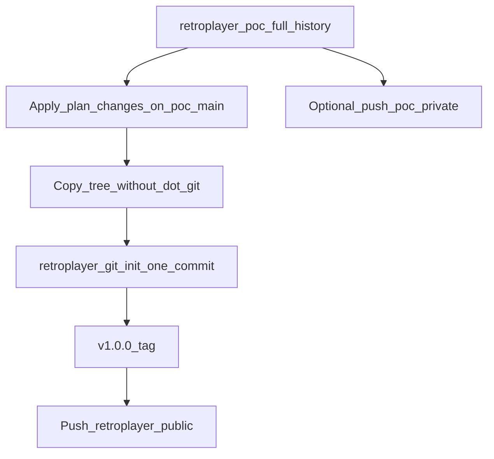

# Prepare Retro Player for public release

Working plan (saved from Cursor planning session). **Status:** not yet implemented — todos below are a checklist.

**Overview:** Harden the tree for public release, then split into two repos — private/local `retroplayer_poc` (full history) and a new `retroplayer` repo with a single clean v1.0.0 history. **Public host:** GitHub [`r-e-t-r-o-p-l-a-y-e-r/retroplayer`](https://github.com/r-e-t-r-o-p-l-a-y-e-r/retroplayer) (first push manual — Phase C).

**Two phases:**

| Phase | Focus | Detail doc |
|-------|--------|--------------|
| **1** | OSS-ready repo (GPL, naming, schema v1, CI, host) | This file — checklist below |
| **2** | Distribution (stores, Linux artifacts, user guide, release CI) | [Distribution (Phase 2)](#distribution-phase-2) + [`RELEASE_CI.md`](RELEASE_CI.md), [`STORE_LOCALES.md`](STORE_LOCALES.md), [`store-listings/`](../store-listings/), [`USAGE.md`](USAGE.md) |

Complete **Phase 1** before first store submissions (license, clean public tree, release signing). Phase 2 can start in parallel for docs and listing copy.

**Distribution scope:** Android (Google Play, F-Droid, Aptoide) and Linux (GitHub Release tarball, Flathub). **Not in scope:** App Store / iOS CI, Windows desktop / Microsoft Store.

## Checklist (Phase 1)

| ID | Task | Status |
|----|------|--------|
| `ci-codegen` | Add `build_runner` + `stamp_build_info` to `.github/workflows/test.yml`; verify full test suite locally | done |
| `oss-docs` | Add CONTRIBUTING.md, SECURITY.md, issue/PR templates; README present-tense polish (Linux taskbar §, quick start) | done |
| `naming-cleanup` | [`scripts/check-no-legacy-names.sh`](../scripts/check-no-legacy-names.sh) in CI; README Linux § trimmed | done |
| `drift-schema-v1` | Reset Drift `schemaVersion` to 1, drop `onUpgrade` chain; update ARCHITECTURE/docs; dev DB wipe note | done |
| `vendor-doc` | [`packages/just_audio_media_kit/VENDORED.md`](../packages/just_audio_media_kit/VENDORED.md) | done |
| `license-copy` | GPL-3.0-or-later in LICENSE + README + pubspec | done |
| `fresh-repo-split` | Rename current tree to `retroplayer_poc`; init new `retroplayer/` with one v1.0.0 commit; smoke-test | done |
| `host-deferred` | pubspec + store privacy URLs → `r-e-t-r-o-p-l-a-y-e-r`; **first push manual** (Phase C) | in progress |

---

## Current baseline (good)

- [`LICENSE`](../LICENSE) — **GPL-3.0-or-later**
- [`README.md`](../README.md) — features, format matrix, strong privacy section, dev setup (already documents `build_runner` + `stamp_build_info.dart`)
- [`doc/README.md`](README.md) + [`REQUIREMENTS.md`](REQUIREMENTS.md) — credible OSS documentation
- [`.github/workflows/test.yml`](../.github/workflows/test.yml) + [`.github/dependabot.yml`](../.github/dependabot.yml)
- **Public tree:** `retroplayer/` — single commit `Initial public release v1.0.0`, tag **`v1.0.0`**, on **`main`**; full history in local **`retroplayer_poc/`**
- Git remote: add **`origin`** before Phase C push (see below)
- Secrets: Android keystores gitignored; no `.env` in tree; **commit author email only lives in git history** (public repo avoids this via two-repo split)

## Gaps to fix before exporting to the new public repo

### 1. CI must match a fresh clone

Generated code is **not** committed ([`.gitignore`](../.gitignore): `*.g.dart`, `*.freezed.dart`, `*.mocks.dart`, `lib/build_info.dart`), but CI today only runs `flutter pub get` → analyze → test. That will fail on a clean checkout.

Add steps after **Install dependencies** in [`.github/workflows/test.yml`](../.github/workflows/test.yml):

```yaml
- name: Generate code
  run: dart run build_runner build --delete-conflicting-outputs
- name: Stamp build info
  run: dart run scripts/stamp_build_info.dart
```

Then run locally (same as CI): `flutter pub get`, codegen, stamp, `dart analyze --fatal-infos`, full `flutter test` (+ Linux integration tests).

### 2. Vendored dependency story

[`pubspec.yaml`](../pubspec.yaml) overrides [`packages/just_audio_media_kit`](../packages/just_audio_media_kit/) (Linux/iOS MPV fixes). Public readers need a short, honest explanation:

- Add [`packages/just_audio_media_kit/VENDORED.md`](../packages/just_audio_media_kit/VENDORED.md) (or a subsection in root README): upstream URL, why the fork lives in-tree, license (public domain in upstream LICENSE), intent to upstream or track releases.

### 3. Community / security files (lightweight, not bureaucratic)

| File | Purpose |
|------|---------|
| [`CONTRIBUTING.md`](../CONTRIBUTING.md) | Clone → codegen → stamp → test; TDD expectation; link to [`AUTOMATED_TESTING.md`](AUTOMATED_TESTING.md) |
| [`SECURITY.md`](../SECURITY.md) | Local-only threat model; report via GitHub Issues once host exists; no shipped telemetry |
| [`.github/ISSUE_TEMPLATE/bug_report.yml`](../.github/ISSUE_TEMPLATE/bug_report.yml) | Platform, steps, expected vs actual (optional feature template) |
| [`.github/pull_request_template.md`](../.github/pull_request_template.md) | Test command + doc updates checkbox |

Skip a heavy Code of Conduct unless you want one; GPL + CONTRIBUTING is enough for many solo OSS apps.

### 4. README polish — describe **what is**, not past fixes

In [`README.md`](../README.md), use present-tense behavior only. No commit hashes, “removed in …”, or migration notes.

**Linux taskbar block (~78–93):** Do **not** mention `hicolor/index.theme`, blank-desktop recovery, or `rm` commands — public readers never need it. Keep a short **current-state** note only, for example:

- On GNOME/KDE, the app installs `app.retroplayer.desktop` and `app.retroplayer.png` icons under `~/.local/share/` on startup (from the bundle).
- If the taskbar icon looks wrong after a rebuild: run [`scripts/install-linux-desktop.sh`](../scripts/install-linux-desktop.sh) (prefers release bundle), then fully quit and relaunch.

Replace line 84 accordingly (no commit refs, no index.theme). Fix the misplaced `sqlite3` fragment (line 94 → under persistence step 4).

**In-app copy (optional but consistent):** Shorten `dataStorageLinuxTaskbarBody` in [`lib/l10n/app_en.arb`](../lib/l10n/app_en.arb) / [`app_de.arb`](../lib/l10n/app_de.arb) — list desktop + icon paths only; drop the index.theme paragraph. Regenerate l10n.

**Implementation detail (not user docs):** [`linux/runner/my_application.cc`](../linux/runner/my_application.cc) and [`scripts/install-linux-desktop.sh`](../scripts/install-linux-desktop.sh) may still avoid writing or remove a bad user `index.theme` internally; trim script stderr that references old commits and the post-install “Removed user hicolor/index.theme…” echo.

Elsewhere in README:

- Add a **Status** line: v1.0.0, no analytics, local files only.
- Add **Quick start** (clone → pub get → codegen → stamp → run) mirroring CI.
- Badges only after a host URL exists.

Optional later: screenshots under `doc/images/`.

### 4b. License — GPL-3.0-or-later (chosen)

Replace [`LICENSE`](../LICENSE) with full GPL-3.0-or-later text. Update README **License** section, `CONTRIBUTING.md` (contributions under GPL), and [`pubspec.yaml`](../pubspec.yaml) `license:` field if used. In-app Settings → open source licenses still lists **dependencies** separately.

Flutter and typical pub dependencies (MIT/BSD/Apache) are compatible with a GPL-licensed app you distribute. The in-tree `just_audio_media_kit` fork is public domain upstream.

### 5. `pubspec.yaml` metadata

Public GitHub repo: **`https://github.com/r-e-t-r-o-p-l-a-y-e-r/retroplayer`**

Add to [`pubspec.yaml`](../pubspec.yaml) before or with the first public push:

```yaml
repository: https://github.com/r-e-t-r-o-p-l-a-y-e-r/retroplayer
issue_tracker: https://github.com/r-e-t-r-o-p-l-a-y-e-r/retroplayer/issues
```

(`homepage` optional — can point to README or a future site.)

Store privacy URLs in [`store-listings/source.en.json`](../store-listings/source.en.json) use `r-e-t-r-o-p-l-a-y-e-r`; refresh locales via `scripts/mt_store_listings.py`.

### 6. Legacy naming cleanup

Canonical IDs: **`retroplayer`** / **`app.retroplayer`**. Pre-release identifiers must not appear in the export tree.

**Gate (CI + before split):**

```bash
./scripts/check-no-legacy-names.sh
```

### 7. Drift database schema **v1** (separate from app release **1.0.0**)

For the first **public** release, ship **schema version 1** only:

- Set `schemaVersion => 1`.
- Remove the entire `onUpgrade` ladder. [`tables.dart`](../lib/data/db/tables.dart) already defines the final shape.
- **No downgrade migration** from dev schema v5 → v1. Document: delete local `retroplayer.db` once after this change.
- Update [`ARCHITECTURE.md`](ARCHITECTURE.md): describe tables under **schema v1** only.
- Run `dart run build_runner build` after `app_database.dart` changes.

**Distinction:** `pubspec.yaml` **1.0.0** = product release; Drift **schemaVersion 1** = first on-disk DB format for that release.

---

## Two-repo split (preferred over in-place squash)

**Idea:** Keep this workspace’s **full git history** in **`retroplayer_poc`** (private backup / reference). Ship **`retroplayer`** as a **new repository** whose first commit is the public v1.0.0 tree.



### Why this fits

| Concern | In-place orphan squash | Fresh `retroplayer` repo |
|--------|-------------------------|---------------------------|
| Old commit emails on public host | Gone after squash | Never uploaded |
| Full dev history | Needs `archive/` branch | Entire `.git` stays in `_poc` |
| Canonical name on host | Awkward rename | Clean `retroplayer` |
| Legacy names in old commits | In history if pushed | Public: clean tree + naming gate only |

Old commit messages in `_poc` may still mention old names — fine **if `_poc` stays private/local**.

### Recommended procedure

**Phase A — prepare in current repo** (`/data/develop/apps/retroplayer` today):

1. Complete plan items (CI codegen, GPL, naming cleanup, schema v1, OSS files, README).
2. Commit on `main` (normal history on poc side).
3. Full test suite green.

**Phase B — split on disk**

```bash
cd /data/develop/apps
mv retroplayer retroplayer_poc

# Copy working tree; include `.env` for local MT/API keys (gitignored — never committed).
rsync -a --exclude '.git' --exclude 'build' --exclude '.dart_tool' --exclude '*.iml' \
  retroplayer_poc/ retroplayer/

cd retroplayer
git init -b main
git add -A
git commit -m "Initial public release v1.0.0"
git tag -a v1.0.0 -m "Retro Player 1.0.0"
```

4. Smoke test in `retroplayer/`: pub get, build_runner, stamp_build_info, flutter test.
5. Open **`retroplayer`** as primary workspace; keep **`retroplayer_poc`** for archaeology.

**Phase C — first push to GitHub (manual; run locally when the public tree is ready)**

Empty repo on GitHub: **`r-e-t-r-o-p-l-a-y-e-r/retroplayer`**. From the **`retroplayer`** directory (after Phase B init, or this workspace once you treat it as canonical):

```bash
git remote add origin https://github.com/r-e-t-r-o-p-l-a-y-e-r/retroplayer.git
git branch -M main
git push -u origin main
```

After the first push, also push tags when ready (e.g. `git push origin v1.0.0`). Confirm [`.github/workflows/test.yml`](../.github/workflows/test.yml) is green on `main`.

| Repo | Visibility | Notes |
|------|------------|--------|
| `retroplayer` | **Public** | `repository` / `issue_tracker` in pubspec point here |
| `retroplayer_poc` | **Private** or local-only | Do not link from public README |

### Alternative: orphan squash in one repo

`git checkout --orphan` + single commit on `main`, history on `archive/pre-public-history`. Use only if you do not want two folders.

---

## Hosting

**Chosen:** public **GitHub** — [`github.com/r-e-t-r-o-p-l-a-y-e-r/retroplayer`](https://github.com/r-e-t-r-o-p-l-a-y-e-r/retroplayer)

| Option | Public discoverability |
|--------|------------------------|
| **GitHub public** (canonical) | Yes; Actions in [`.github/workflows/`](../.github/workflows/) |
| **Cursor Origin** | Optional mirror; not the public listing |
| **`retroplayer_poc`** | Private/local backup of full history |

First push commands: [Phase C — first push to GitHub](#phase-c--first-push-to-github-manual-run-locally-when-the-public-tree-is-ready) above. Optional donations: [`github-sponsors`](#optional-support--github-sponsors-no-in-app-payments) (Sponsors + `FUNDING.yml` after repo is live).

---

## Build matrix (maintainer, Fedora / CI)

| Target | Fedora laptop | GitHub Actions (`ubuntu-latest`) |
|--------|---------------|-------------------------------------|
| **Linux x64 release** | `flutter build linux --release` | Same; canonical release OS for glibc baseline |
| **Android APK/AAB** | [`scripts/build-android.sh`](../scripts/build-android.sh) | PR: debug APK; tag: AAB/APK — see [`RELEASE_CI.md`](RELEASE_CI.md) |
| **Tests** | `flutter test` + libmpv/GTK deps | [`.github/workflows/test.yml`](../.github/workflows/test.yml) |

Linux bundle path: `build/linux/x64/release/bundle/`. Package with [`scripts/package-linux-release.sh`](../scripts/package-linux-release.sh).

---

## Distribution (Phase 2)

Checklist after Phase 1 (or in parallel for documentation only):

| ID | Task | Status |
|----|------|--------|
| `dist-play` | Play Console app, release signing, Data safety (no network, local files), content rating, testing track | pending |
| `dist-fdroid` | F-Droid metadata, fdroiddata MR, reproducible build at git tag, GPL | pending |
| `dist-aptoide` | Developer account, release APK, descriptions from [`store-listings/`](../store-listings/) | pending |
| `dist-linux-tarball` | Tag → GitHub Release tarball + install notes | pending |
| `dist-flathub` | Flatpak manifest, Flathub PR, mpv runtime | pending |
| `store-listings-en` | Canonical English in `store-listings/en/` + `source.en.json` | in progress |
| `store-listings-l10n` | Translated listings (DeepL via `scripts/mt_store_listings.py`); English fallback — [`STORE_LOCALES.md`](STORE_LOCALES.md) | in progress |
| `usage-tutorial` | [`USAGE.md`](USAGE.md), `doc/images/tutorial/`, [`capture-tutorial-screenshots.sh`](../scripts/capture-tutorial-screenshots.sh) | in progress (manual drafted; refresh screenshots / Play link) |
| `release-ci-android` | [`.github/workflows/release.yml`](../.github/workflows/release.yml), Gradle release keystore, secrets doc | pending |
| `release-ci-linux` | Linux job in `release.yml` → tarball artifact | pending |
| `github-sponsors` | GitHub Sponsors + `.github/FUNDING.yml` + README support section (no in-app link) | pending |

**Detail:** CI/CD — [`RELEASE_CI.md`](RELEASE_CI.md). Store copy — [`store-listings/README.md`](../store-listings/README.md). End-user manual — [`USAGE.md`](USAGE.md) (not [`REQUIREMENTS.md`](REQUIREMENTS.md) / dev docs).

### Optional support — GitHub Sponsors (no in-app payments)

Voluntary donations **only on GitHub** (and later F-Droid metadata). The app stays offline: no donation URL in Settings, no `url_launcher`, no `INTERNET` in release builds.

| Step | Action |
|------|--------|
| 1 | After public repo exists (`host-deferred`): apply at [GitHub Sponsors](https://github.com/sponsors), complete Stripe payout setup, define at least one tier; wait for approval. |
| 2 | Add [`.github/FUNDING.yml`](../.github/FUNDING.yml) with `github: <your-username>` (Sponsor button on the repo once Sponsors is enabled). |
| 3 | In [`README.md`](../README.md): short **Support development** section pointing to `https://github.com/sponsors/<username>`; clarify **no in-app purchases** / app does not open payment flows. Adjust Privacy bullet from “No monetization” to **no in-app monetization** if needed. |
| Later | F-Droid **`Donate:`** in fdroiddata when `dist-fdroid` runs — separate from the APK. |

**Out of scope for this track:** PayPal email, in-app “support” tile, store listing donate lines (optional prose later).

**Still out of scope (later):** App Store / iOS release CI; Windows desktop; [`MANUAL_TESTING.md`](MANUAL_TESTING.md) (QA matrix — separate from USAGE).

---

## Success criteria

- **`retroplayer`**: single-commit `main` + `v1.0.0` tag; **`retroplayer_poc`**: full history locally (optional private remote)
- CI green on clean checkout (codegen + stamp in workflow)
- CONTRIBUTING + SECURITY + templates in place
- Vendored MPV package documented
- README present-tense only; Linux taskbar § without index.theme recovery instructions
- `./scripts/check-no-legacy-names.sh` passes repo-wide
- Drift `schemaVersion` 1, no legacy migration ladder in public tree
- GPL-3.0-or-later in LICENSE + README
- Ready to `git push` when host is chosen

**Phase 2 (when distributing):**

- `store-listings/en/` complete; optional locales per [`STORE_LOCALES.md`](STORE_LOCALES.md)
- [`USAGE.md`](USAGE.md) published for store links; tutorial screenshots under `doc/images/tutorial/` (regenerate via script)
- Tag `v*` produces signed AAB/APK + Linux tarball per [`RELEASE_CI.md`](RELEASE_CI.md)
- Optional: GitHub Sponsors live + `FUNDING.yml` on public repo (`github-sponsors`)
