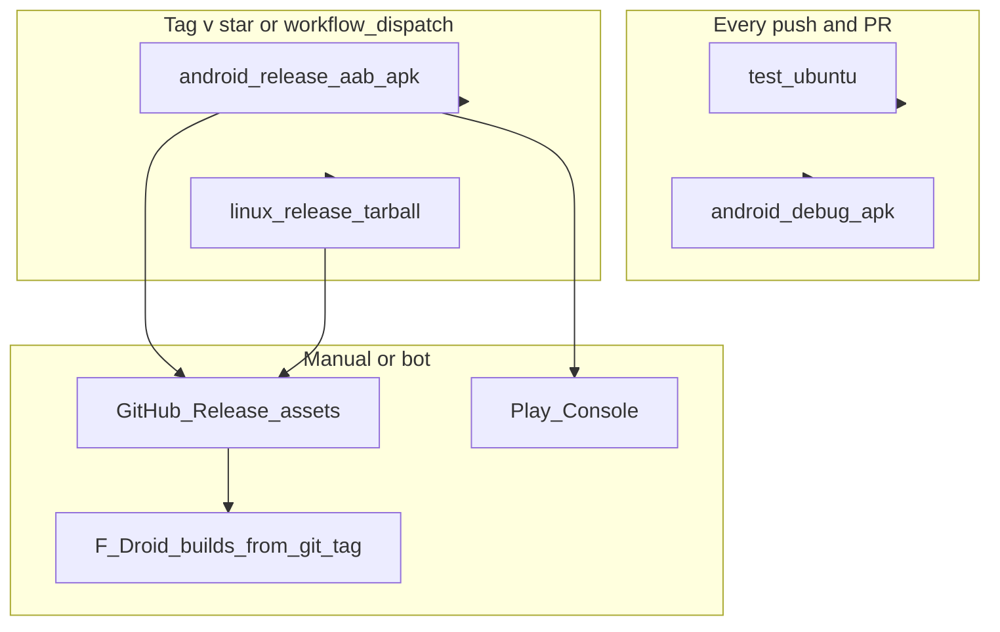

# Release CI/CD (Android + Linux)

Maintainer guide for verify vs release pipelines. Phase 2 of [`PUBLIC_RELEASE_PLAN.md`](PUBLIC_RELEASE_PLAN.md).

**Scope:** Android (AAB/APK) and Linux (release tarball) on `ubuntu-latest`. No iOS or Windows jobs.

## Current verify pipeline

[`.github/workflows/test.yml`](../.github/workflows/test.yml) on every push/PR:

| Job | Output |
|-----|--------|
| `test` | `dart analyze`, full `flutter test`, Linux MPV integration tests |
| `android-apk` | **Debug** APK compile smoke test |

Shared prepare steps (must match local dev):

```bash
flutter pub get
dart run build_runner build --delete-conflicting-outputs
dart run scripts/stamp_build_info.dart
```

Linux tests need **libmpv** runtime + dev headers (`libmpv2` or `libmpv1` plus `libmpv-dev`, depending on Ubuntu version) and the GTK toolchain per `flutter doctor`.

## Planned release pipeline

Add [`.github/workflows/release.yml`](../.github/workflows/release.yml) when release signing is ready:

- **Trigger:** `push` tags matching `v*` and/or `workflow_dispatch`
- **Jobs:** `android-release`, `linux-release` (can run in parallel)
- **Publish:** Upload artifacts to GitHub Release (manual Play upload is fine for v1)



### Android release job

| Item | Detail |
|------|--------|
| Runner | `ubuntu-latest` |
| Before build | `flutter build apk --config-only` (see [`scripts/_android_env.sh`](../scripts/_android_env.sh)) |
| Build | `flutter build appbundle --release` + optional `flutter build apk --release` (Aptoide/sideload) |
| Signing | GitHub secrets → `android/key.properties` + keystore file (never commit). Wire release `signingConfigs` in [`android/app/build.gradle.kts`](../android/app/build.gradle.kts) when `key.properties` exists. |
| Secrets | `ANDROID_KEYSTORE_BASE64`, `ANDROID_KEYSTORE_PASSWORD`, `ANDROID_KEY_ALIAS`, `ANDROID_KEY_PASSWORD` |

**Today:** release build type still uses debug signing in Gradle — change before Play/Aptoide.

F-Droid rebuilds from your **git tag**; CI proves the tag compiles and supplies Play/Aptoide binaries.

### Linux release job

| Item | Detail |
|------|--------|
| Runner | `ubuntu-latest` |
| Deps | Same as CI tests: `libmpv2` or `libmpv1`, `libmpv-dev`, `libgtk-3-dev`, `cmake`, `ninja-build`, `pkg-config`, `clang` |
| Build | `flutter build linux --release` |
| Package | [`scripts/package-linux-release.sh`](../scripts/package-linux-release.sh) → `retroplayer-<version>-linux-x64.tar.gz` + optional `.sha256` |

Document in release notes: built on Ubuntu runner glibc; runtime needs compatible **libmpv** until Flatpak ships.

### Local release (Fedora)

Same commands as CI after prepare steps:

```bash
./scripts/build-android.sh appbundle   # or apk
flutter build linux --release
./scripts/package-linux-release.sh
```

Official releases should use one canonical CI OS (Ubuntu) for reproducibility.

## GitLab CI mirror

Optional [`.gitlab-ci.yml`](../.gitlab-ci.yml): stages `verify` and `release`; Flutter image `ghcr.io/cirruslabs/flutter:3.47.8`; protected tag variables for keystore. Same two release jobs — no macOS/Windows runners.

Example sketch:

```yaml
stages: [verify, release]
variables:
  FLUTTER_VERSION: "3.47.8"
```

See inline examples in planning notes; copy from this doc when adding GitLab.

## Tutorial screenshots in CI (optional)

Not required for store release. Heavy option: `workflow_dispatch` + KVM emulator, or run [`scripts/capture-tutorial-screenshots.sh`](../scripts/capture-tutorial-screenshots.sh) locally on Fedora.

## GitHub repo extras (after first public push)

Not part of CI jobs. Do when [`host-deferred`](PUBLIC_RELEASE_PLAN.md) is done — see **`github-sponsors`** in [`PUBLIC_RELEASE_PLAN.md`](PUBLIC_RELEASE_PLAN.md#optional-support--github-sponsors-no-in-app-payments):

1. Enable **GitHub Sponsors** + Stripe for the account that owns the public repo.
2. Commit **`.github/FUNDING.yml`** (`github: <username>`).
3. README **Support development** (Sponsors URL only; app unchanged).

Release and verify workflows do not need changes for Sponsors.

## Checklist IDs

Maps to [`PUBLIC_RELEASE_PLAN.md`](PUBLIC_RELEASE_PLAN.md): `release-ci-android`, `release-ci-linux`, `github-sponsors`.
