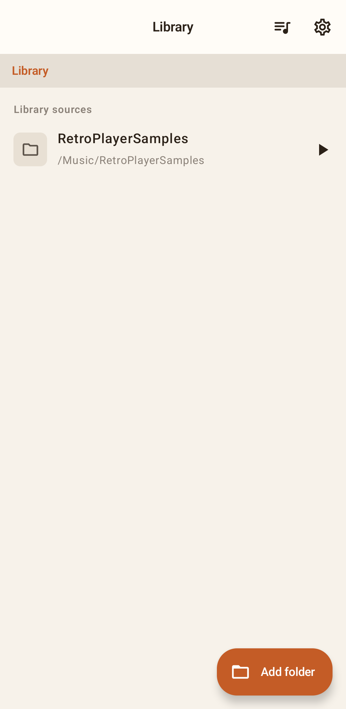
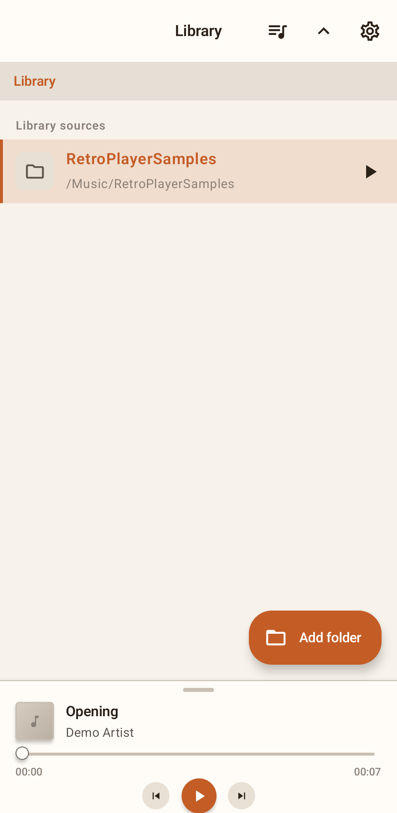
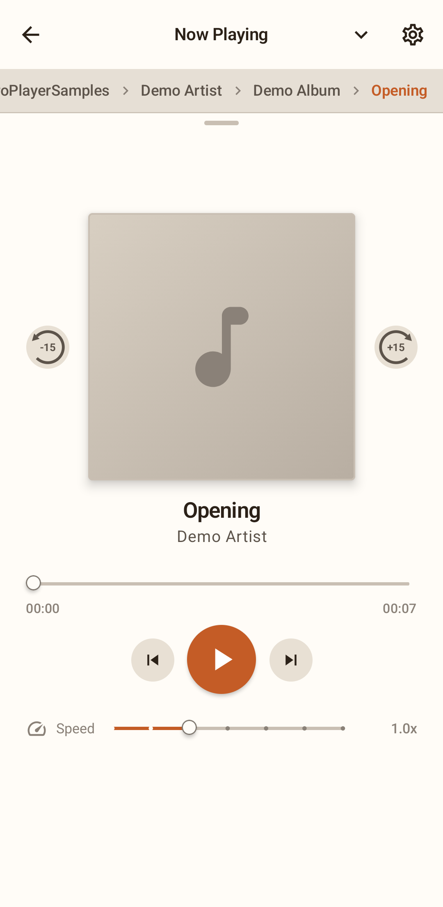
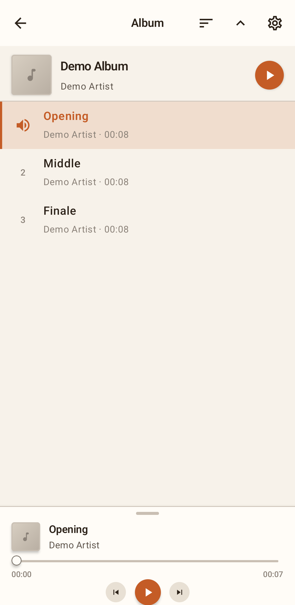
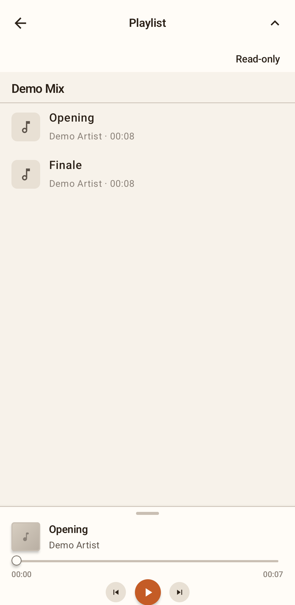
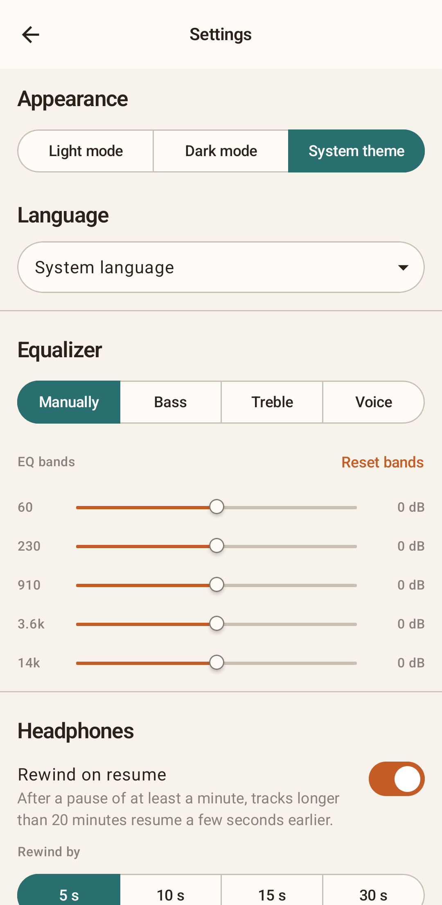

# Retro Player — user guide

Retro Player plays **music and audiobooks from folders on your Android device**. It does not upload your files, stream from the internet, or change your audio files on disk (except playlists you create inside the app).

Screenshots in this guide: [`images/tutorial/`](images/tutorial/).

---

## Getting started

### First launch

When you open the app for the first time, the library is empty. Add at least one **library folder** (a directory that contains your audio files or subfolders).

### Add a library folder

Retro Player asks for no storage permission.

1. Open **Library**.
2. Tap **Add folder**.
3. In the system folder picker, choose a folder (for example `Music`, an audiobook collection, or an SD card directory), tap **Use this folder** and **Allow**.
4. Wait while the app scans. Folders and albums appear as tags are read.

The app can then read that folder and everything below it, and nothing else. It cannot change your files.

**Order:** long-press a library source or a favorite and drag it to change the order.

**Remove a library source:** on the library root screen, swipe a source row to the left and confirm. The folder is only removed from the app; nothing is deleted on disk. Playback stops if it was playing from that folder.

---

## Browse your collection

The library works like a **file browser**:

- Tap a **folder** to open it.
- **Breadcrumbs** at the top show where you are; tap a segment to jump to that parent folder. When you go back up, the list returns to the same scroll position as when you entered the folder.
- At the **library root**, you see your added sources and any **favorite folders** (starred shortcuts).
- **Swipe right** on a folder to add or remove it from favorites (favorites are links, not copies of files).
- **Swipe left** on a folder, favorite, playlist, album or track to add it to the queue. The app says how many tracks were added.
- Long lists show an **A–Z bar** on the right. It covers the whole alphabet, plus **#** for names starting with a digit and **•** for other characters. Tap a letter or slide along the bar; a letter without entries jumps to the next one.

**Album rows:** tracks in the same folder are often grouped into one **album** (by tags or folder). Tap the album to see tracks; tap **▶** on a row to start that album or folder.

**Playlists on disk:** `.m3u` / `.m3u8` files in a folder appear as playlist entries. They are read-only; the app does not edit those files.

---

## Play music or audiobooks

- Tap **▶** on a folder, album, or playlist row, or tap a **track** in an album view.
- Playback is **gapless** within an album or queue where the format allows it.
- The app **remembers position** per album, folder, or playlist. After you fully quit and reopen, press **Play** to continue where you left off (nothing auto-plays on startup).

---

## Player controls

### Mini player and expanded player

- A **mini player** sits above the library while something is loaded.
- **Swipe up** on the handle or use the expand control in the app bar to open the full player sheet.
- **Swipe down** or tap collapse to show more of the library again.

### While playing

| Action | How |
|--------|-----|
| Play / pause | Button, notification, lock screen or widget |
| Previous / next track | Buttons, notification or lock screen |
| Seek | Progress bar |
| Skip 15 s | **−15** / **+15** beside the art, or double-tap left/right on the art (expanded) |
| Playback speed | Speed control, 0.5×–2.0×, saved per item |

Background playback continues with the screen off. Use the **notification** to control playback. Fully closing the app from recents stops playback and saves position.

### Chapters

M4B and M4A audiobooks with chapters show chapter marks on the progress bar and the current chapter under the title. Tap it for the chapter list. Previous and next chapter buttons appear in the player and in the notification.

---

## Album and track views

Open an album from the library to see its track list.

- Tap a track to play from that track.
- The sort button switches between **tag order**, **file name** and **title**. The choice is kept per album. When some tracks have no track number, the album uses file name order; choosing tag order then asks first.
- Tap **album art or title** in the player to **find the current track** in the library: the player collapses, the app opens the right folder or album, and highlights the playing row.

---

## Queue and playlists

- Open the **queue** from the library app bar to build a temporary play order.
- Add tracks, reorder with long-press drag, swipe to remove rows, or clear the queue (with confirmation).
- Tap a row in the queue to start playback from that track.
- **Save playlist** asks for a name and a folder inside one of your library folders, then writes a new playlist file there. Only playlists the app created can be edited or deleted; playlist files you copied in yourself stay read-only in the app.

**Write access:** folders are added read-only. The first time you save a playlist into a library folder, the system folder picker opens at that folder: confirm it to give Retro Player write access there. If you pick a different folder or cancel, nothing is saved and everything else keeps working. Retro Player only ever writes playlist files it created itself.

---

## Back navigation

1. Close Settings (or a Settings subpage) if open.
2. If the player is **expanded**, collapse it first.
3. If an **album or playlist page** is open, close it.
4. If you are **inside a folder**, go up one level (scroll position on the parent is restored).
5. On the **library root**, back does not exit the app (use the system app switcher to quit). Swiping the app away in recents stops audio.

---

## Settings

Open **Settings** from the gear in the app bar.

- **Appearance** — light, dark, or follow system.
- **Language** — app language (many locales available), or the system language.
- **Equalizer** — presets and bands where supported on your device.
- **Headphones**:
  - **Rewind on resume** (on by default): after a pause of at least a minute, tracks longer than 20 minutes start a few seconds earlier (5, 10, 15 or 30 s), so you do not lose the thread.
  - **Resume when headphones reconnect** (off by default): when playback paused because headphones were disconnected, it continues once they are connected again within 10 minutes. This works for wired, USB and Bluetooth devices, including car audio over Bluetooth.
- **Data & storage** — what the app stores; library roots; reset options.
- **About** — version and open-source licenses.

**Reset database** clears playback state, favorites, browse position, theme, language, and equalizer settings. You can keep listed library folders or remove everything and start with an empty library. **Your audio files on disk are never deleted.**

---

## Android Auto and widget

**Android Auto:** in the car, Retro Player shows your library sources (with their folders, albums, playlists and tracks), your favorites and the queue. Playing something there works as on the phone, including resume.

**Home-screen widget:** long-press the home screen, open **Widgets** and add **Retro Player**. The small widget shows the title and play/pause; larger sizes add the cover, ±15 s jumps and previous/next. Tap the widget to open the app.

---

## Supported formats

| Format | Typical use |
|--------|-------------|
| FLAC, MP3, OGG, Opus, WAV | Music and audiobooks |
| M4A, M4B | AAC / audiobooks (unencrypted) |

The app plays **local files only**. Remote URLs in playlist files are ignored.

---

## Privacy

Retro Player has **no Internet access**: no ads, analytics, accounts or in-app purchases. The app reads only folders you add. Details: [PRIVACY.md](../PRIVACY.md).

---

## Something wrong?

Report bugs on [GitHub](https://github.com/r-e-t-r-o-p-l-a-y-e-r/retroplayer/issues) with your **device and Android version**, where you installed the app from, the **steps**, and what you expected. Security issues: see [SECURITY.md](../SECURITY.md).

## Support

Retro Player is free software. If you want to support its development: [liberapay.com/retroplayer](https://liberapay.com/retroplayer).

---

## For maintainers (screenshots)

Tutorial PNGs live in [`images/tutorial/`](images/tutorial/); how to capture them: [`images/tutorial/README.md`](images/tutorial/README.md).
